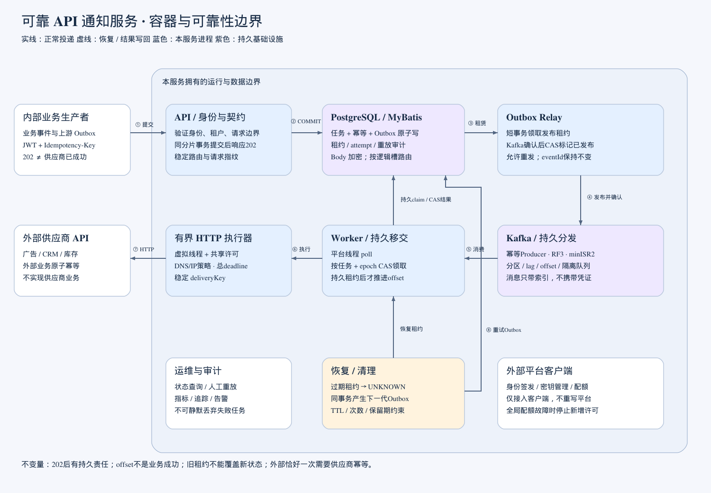

# 可靠 API 通知服务

接收内部业务系统提交的通知，持久化后通过Kafka异步投递到外部HTTP(S) API。项目采用Java 21编译目标、Spring Boot / Spring Cloud、MyBatis、PostgreSQL、Kafka和有界虚拟线程。

**当前已提供可运行的业务闭环，不再只有骨架。** `runtime`模式支持JWT认证、幂等接收、状态/尝试查询、审计重放、事务Outbox、Kafka投递、HTTP重试、租约恢复及保留期清理。`scaffold`模式仍保留501占位行为，供无基础设施的结构演示。

## 从哪里开始

| 文档 | 内容 |
| --- | --- |
| [系统设计](docs/system-design.md) | 架构、组件、数据、接口、一致性、安全和容量目标 |
| [架构视图](docs/architecture.md) | 容器图、信任边界、时序与部署视图 |
| [深度审查](docs/design-review.md) | 原始问题、修订决策和实际验证边界 |
| [AI排障案例](docs/ai-debugging-case.md) | 本轮真实CI失败、最小复现、修复与故障演练 |
| [对抗式模拟面试](docs/mock-interview.md) | 面试官追问、候选人回答及证据要求 |
| [Kafka专项设计](docs/kafka-reliability.md) | 参数、部署、offset、PG热点与虚拟线程 |
| [运行与运维](docs/runtime-and-operations.md) | 演示、环境变量、外部配额契约、迁移、发布及故障处置 |
| [验证记录](docs/verification.md) | 实际执行结果与明确未验证的项目 |
| [接收性能分析](docs/acceptance-performance.md) | 冷启动/预热后数据、TDD优化及已停止的对照实验 |
| [AI会话归档说明](docs/conversation-archive.md) | 完整公开会话快照、zip内容和完整性校验 |
| [HTTP OpenAPI](contracts/openapi.yaml) | 四个业务接口、权限和错误约定 |
| [Kafka事件Schema](contracts/dispatch-event.schema.json) | 不携带Body/凭证的版本化调度事件 |



## 运行本地演示

需要JDK21、Python和Docker Compose。Windows把`./mvnw`替换成`.\mvnw.cmd`，Python虚拟环境可执行文件位于`.venv\Scripts`。

```sh
./mvnw clean verify
python -m venv .venv
.venv/bin/pip install -r requirements-dev.txt
docker compose -f compose.test.yaml up -d --wait
.venv/bin/python scripts/prepare-demo.py
.venv/bin/python scripts/run-demo.py migrate
.venv/bin/python scripts/run-demo.py bootstrap
```

三个终端分别运行：

```sh
.venv/bin/python scripts/mock-external-services.py
.venv/bin/python scripts/run-demo.py api
.venv/bin/python scripts/run-demo.py worker
```

再运行：

```sh
.venv/bin/python scripts/load-smoke.py --requests 64 --concurrency 8
```

烟测不仅检查202，还会等待每条任务最终SUCCEEDED。API默认`127.0.0.1:8080`，Worker健康检查默认`127.0.0.1:8081`。`/actuator/health/liveness`检查进程；readiness按角色检查运行状态。测试JWT与配置位于被忽略的`tmp/demo`，不是生产凭证。详细操作和手动HTTP示例见运行文档。

## 测试与CI

```sh
# 无外部依赖的单元/组件测试
./mvnw clean verify

# 真实PG/Kafka集成测试，必须显式提供测试连接
export TEST_PG_URL=jdbc:postgresql://localhost:15432/notification
export TEST_PG_USER=notification
export TEST_PG_PASSWORD=notification_test
export TEST_KAFKA_BOOTSTRAP=localhost:19092,localhost:19093,localhost:19094
export TEST_KAFKA_REPLICATION=3
./mvnw -Pintegration clean verify
```

集成测试使用随机schema和topic，结束时只清理自己的测试数据。没有基础设施时明确失败，不以skip冒充通过。测试涉及真实签名JWT、真实API进程、并发幂等、事务回滚、MyBatis类型绑定、相同事件重复、供应商503、重放、旧租约写回、offset提交后丢失内存执行、目标版本变更、保留期和分片路由。

[GitHub Actions](https://github.com/xiedeacc/rc_bill/actions/workflows/ci.yml)运行真实PG、三个Kafka broker、端到端测试、演示和容器检查。完整结果与失败证据保存在Actions artifacts及[ci-evidence分支](https://github.com/xiedeacc/rc_bill/tree/ci-evidence)。`notification-release`是默认关闭发布/部署的手动工作流，只接受已经通过精确commit验证的master版本。

## 核心保证与边界

- 202表示任务、幂等记录和Outbox同分片提交成功，不表示供应商已完成业务。
- 入口唯一约束、稳定路由、请求指纹处理重复提交；Kafka重投通过任务状态与调度代次去重。
- offset只在持久移交后推进；提交offset后的进程退出由租约恢复器产生新的Outbox事件。
- HTTP不持有数据库事务，不自动重试或跟随重定向；总预算包含有界DNS解析，重试由持久调度控制。
- 所有外部重试/人工重放保留deliveryKey。供应商不支持原子幂等时，无法承诺外部业务恰好执行一次。
- AES-GCM密文绑定任务ID；调用方不能提交目标URL或凭证引用。生产默认HTTPS443，额外origin需显式配置，供应商私网/DNS防护仍保留。
- 默认每任务24小时内最多20次网络尝试；Body终态后7天清理，元数据至少30天，活跃重放链或未完成持久责任会延长保留。

广告、CRM、库存、身份签发和共享配额平台均属于外部边界。仓库只实现客户端交互与测试替身。**生产必须落实真实共享配额接口或替换相应适配器；本地mock不是生产限流服务。**

## 代码结构

```text
notification-domain/       纯Java状态、ID、事件和重试决策
notification-application/  用例、输入指纹、背压、执行容量和端口
notification-adapters/     MyBatis/PG、加密、配置、HTTP、配额和Kafka发布
notification-api/          JWT安全链、严格请求解析、四个HTTP接口
notification-worker/       Relay、消费、恢复、清理、迁移与初始化入口
contracts/                 HTTP与消息契约
deploy/k8s/                 环境适配后使用的生产部署模板
scripts/                   本地演示、合同检查、镜像验证与证据收集
```

没有实现周边业务服务，也没有用内存队列假装持久接收。具体模块和TDD/提交规则见[AGENTS.md](AGENTS.md)。

## 生产验收与作业清单

平均2万、峰值10万通知/秒，以及64 PG主分片/2048 Kafka分区，是待压测的容量模型，不是已达到的性能。本地默认1数据源、16分区；连接预算、部署拓扑、供应商限额和分片故障域必须在真实环境验证。固定路由拓扑不能随意改数量或重排URL；没有实现在线自动迁移分片。

Kubernetes模板、镜像构建与手动发布流程已经提供，尚未向真实生产集群部署。真实SLO、跨AZ/跨区域恢复、环境专用Egress、在线数据key轮换和供应商特定业务返回码判定仍需相应环境/协议验收，不能由本仓库的mock证明。

- [x] 保留原始[作业PDF](AI_Coding_作业_2026-10-29.pdf)。
- [x] 系统设计、审查、AI案例、模拟面试和可运行代码。
- [x] 单元/组件与真实基础设施集成测试、CI和发布入口。
- [x] Git仓库和可审查的提交/修复证据。
- [x] 本项目截至归档时间的全部可导出公开会话已打包为根目录 `AI_会话记录_2026-11-03.zip`；保留用户消息、AI公开回复及工具活动原文，范围和截止点见[归档说明](docs/conversation-archive.md)。后续新增消息须另行更新快照。

原有`invite.ics`保持不变且不提交。请勿把真实凭证或个人信息放入后续会话或仓库。
