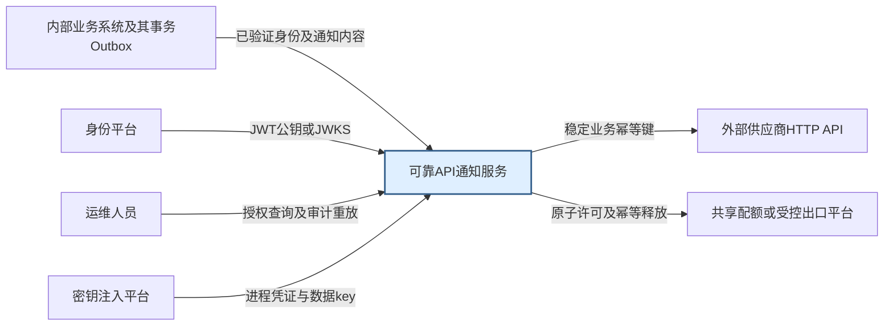
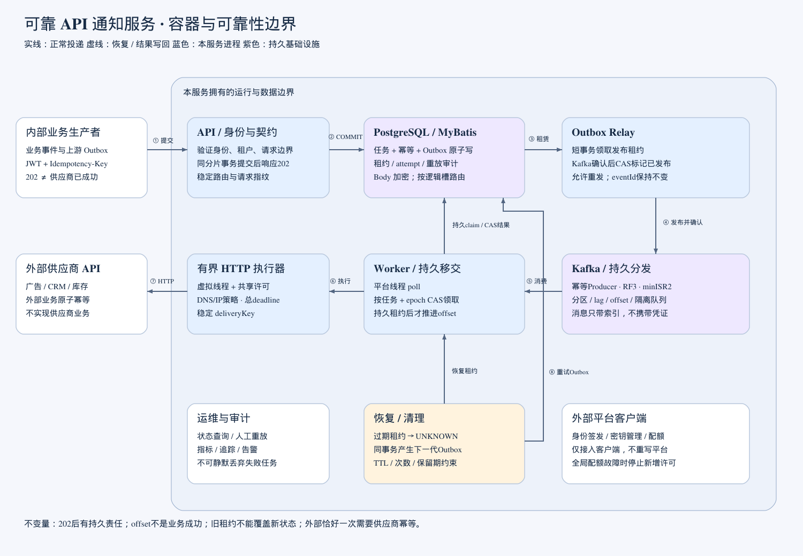
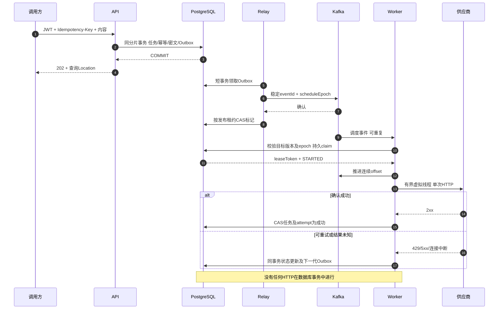
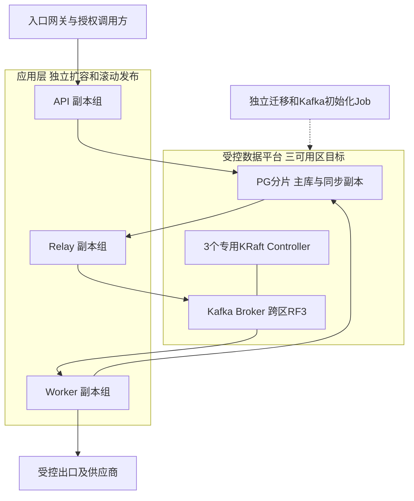
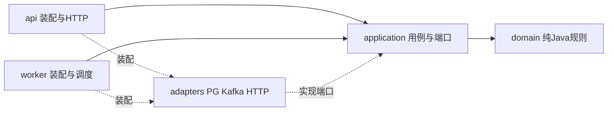

# 架构视图与责任边界

本文件将系统上下文、运行组件、提交时序和目标部署拆开，避免一张图混杂全部抽象层次。源码已实现业务链路；大规模部署图表示容量模型，并不是已部署集群。

## 系统上下文

本服务不实现业务事件生产、广告归因、CRM联系人状态、库存逻辑、身份签发或配额平台服务端。测试替身用于验证交互和故障处理，不能证明供应商或平台自身正确。

## 容器与持久责任

[SVG可缩放版本](diagrams/architecture.svg)。蓝色框是应用运行角色，紫色框是持久基础设施，虚线表示恢复和写回。数据库提交、Kafka确认、offset提交和供应商响应是四种不同的事实。

| 提交点 | 谁拥有后续责任 | 进程此刻退出时 |
| --- | --- | --- |
| API同库COMMIT | notification及Outbox | 客户端同key重试取回原任务；Relay继续发布 |
| Kafka确认但Outbox未标记 | Outbox与Kafka均可能有事件 | 允许重发相同event，按任务代次去重 |
| PG claim提交但offset未提交 | 持久租约 | 消费重读只能识别已有租约，不重复领取 |
| offset提交但HTTP未开始 | 持久租约与恢复器 | UNKNOWN后同事务创建下一代Outbox |
| 供应商已执行但结果未写回 | 外部可能已生效，本地结果未知 | 保持deliveryKey重试；需供应商幂等 |

## 关键时序

## 部署视图

本地及CI使用1个PG服务器和同机3个Kafka broker；分片测试使用两个隔离schema及独立数据源。生产目标中的跨AZ、同步复制、64物理主分片与2048分区需要真实环境验收，不能从该图或单机测试推断已达到。

Kubernetes模板默认少量副本，Worker可以先使用all角色，也能拆为relay/dispatch。API readiness避免因一个共享分片故障把所有API副本摘除；受影响请求返回503，总体health与后台恢复日志仍报告依赖异常。后台逐分片处理，单分片失败不会直接跳过其后的健康分片；冷启动仍要求配置与路由校验成功，不声称已实现在线自动搬迁。

## 模块依赖

纯规则可以不启动Spring测试；数据库语义必须用PG，消息协议必须用Kafka。边界图不替代测试，具体证据见[验证记录](verification.md)。
