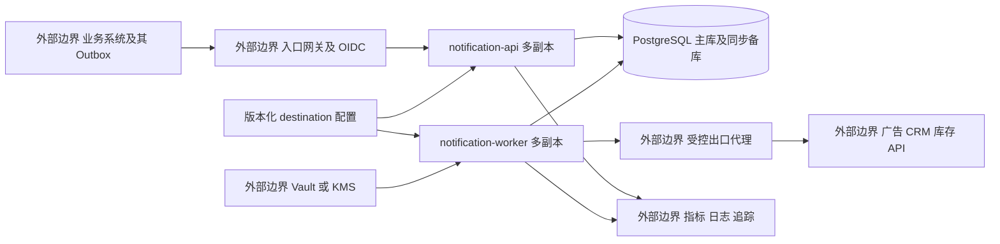
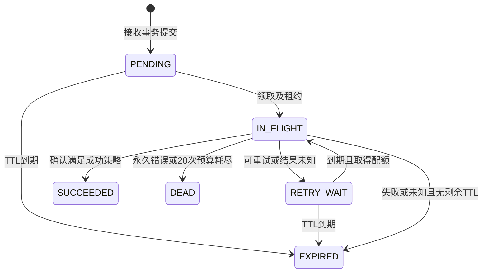
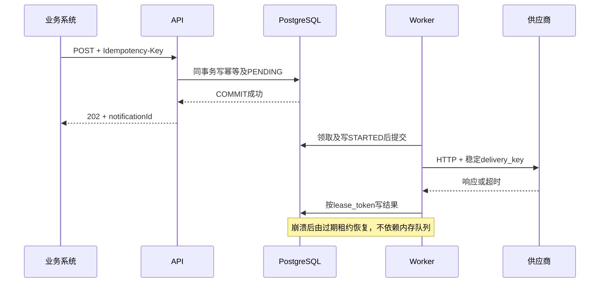

# 可靠 API 通知服务系统设计

版本：1.0。日期：2026-11-02。项目：rc_bill。状态：设计基线与代码骨架，业务实现待后续迭代。

本服务接收内部业务系统的通知请求，将其可靠地投递给外部 HTTP(S) API。API 接收与外部投递解耦，以 PostgreSQL 持久任务、幂等记录和租约为一致性边界，采用 Spring Boot 与 Spring Cloud 构建两个可独立扩容的进程。系统承诺在配置的期限与故障假设下持续尝试投递，并显式保留失败任务；不能承诺任意供应商永远可用，也不能单方面保证外部业务恰好执行一次。

本次只完成设计、OpenAPI、模块接口、构建和启动骨架。本文中的业务流程、数据库结构、安全控制、容量与 SLO 均为待实现的目标，不代表已通过生产验证。集成测试与 CI/CD 按作业范围标注 TODO，不在本阶段实现。完整开发周期计划另行编写。

## 1 需求与边界

### 1.1 原始要求对应

需求来源：根目录 `AI_Coding_作业_2026-10-29.pdf`，共一页。

| 题目要求 | 设计落点 |
| --- | --- |
| 多个内部业务系统提交通知 | 租户与调用方隔离、POST 接口、配额、入口幂等 |
| 广告注册、CRM 状态、库存变更等通知 | 统一投递内核；供应商模板只描述 HTTP 交互，不实现周边业务 |
| 不同 URL、Header 和 Body | 受控且版本化的 destination 配置，调用方提供已适配的 Body 和允许的动态 Header |
| 调用方不关心外部返回内容 | 提交返回任务 ID；只暴露投递状态和错误分类，不回传供应商原始响应 |
| 可靠送达 | durable acceptance、持久重试、故障恢复、死信与人工重放、审计 |
| GitHub 仓库及 README | 本地 Git 和 README；发布远端属于后续交付 |
| 完整未删改 AI 会话 zip | 最终交付检查项；当前会话尚未结束，最终导出后入库，不以人工摘要冒充原始会话 |

### 1.2 服务所有权

本服务负责接收、校验、持久化、调度、发送、结果分类、状态查询、人工重放和运行可观测性。范围包含 destination 配置加载与校验，但第一版不做管理 UI 或配置管理 API；采用经审查的部署配置发布不可变版本。

业务事件生产者负责“业务事务提交后必有通知请求”，应通过自己的事务 Outbox 重试调用本服务；它不是本服务实现范围。广告平台、CRM、库存系统、OIDC 身份平台、Vault/KMS、出口代理、监控平台均作为外部依赖，只实现本服务侧适配器。测试不得连接真实供应商或修改真实库存。

### 1.3 设计假设

- 通知互相独立，不保证跨请求 FIFO；库存等顺序敏感调用必须由对方按事件版本拒绝旧事件，或者未来另行引入 ordering key 与串行消费，第一版不宣称有序。
- 默认只允许 HTTPS 443。题目中的 HTTP 兼容限定为经过安全审查的专用受控出口，不能由请求临时开启。
- 调用者提交目标所需的 UTF-8 Body 原文，可用于 JSON、表单或纯文本；服务不实现任意脚本、模板表达式、XML 解析或业务字段转换。复杂转换由业务方或后续专门适配器承担。
- 单通知一个 destination，一个请求不跨多个供应商扇出；业务方需要多个通知时使用不同幂等键分别提交。
- destination 不允许业务方任意指定 URL。管理员预配置 URL、method、允许 Header、Body 类型、授权凭证引用和供应商成功判定规则。
- 以下容量为明确的初始设计预算，需压测后调整；并非题目给定数据。

## 2 服务等级与交付语义

| 项目 | 设计目标与条件 |
| --- | --- |
| 接收可用性 | 月度 99.9%；以合法授权请求为分母，容量拒绝计入可用性损失，排除调用方 4xx |
| 接收延迟 | 峰值预算内 P95 ≤ 150 ms，P99 ≤ 300 ms；包含数据库提交，不含外部投递 |
| 首次尝试 | 供应商健康、未触发配额且无积压时，99% 在接收后 5 秒内开始 |
| 持久性 | 已确认接收的任务在单实例/单数据库节点故障下 RPO 0，依赖同步副本与可靠存储；区域全毁另设 RPO ≤ 5 分钟 |
| 恢复 | 应用故障由其他实例接管；数据库故障切换目标 ≤ 60 秒；区域恢复目标 RTO ≤ 60 分钟，需演练 |
| 重试期限 | 默认 24 小时，最多 20 次网络尝试，先到者为准；可请求 60..86400 秒较短 TTL |
| 查询保留 | 终态元数据及尝试记录保留 30 天；Body 终态后 7 天删除；人工重放仅在 Body 存在时允许 |
| 入口幂等保留 | 从原始接收/重放接收起 30 天，且不得早于对应任务进入终态；过期后同 key 可创建新通知 |

202 表示本服务已持久化承担投递责任，不表示供应商成功。入口响应丢失时调用者使用同一 key 重试。供应商成功处理但响应丢失或本服务写回前崩溃时，将再次投递；任务“未确认成功”不等于外部没有产生效果。

整体是至少一次尝试/投递语义，有限 TTL 与永久错误下可能没有成功送达。供应商长期不可用、非法请求或预算耗尽进入 DEAD/EXPIRED 并告警，不能静默删除。只有供应商自身提供足够长的幂等窗口与原子去重，才可保证窗口内一次业务效果；没有幂等能力的库存扣减必须明确承担重复风险，不能伪称 exactly-once。

## 3 架构与技术选择



API 和 Worker 是同一个业务限界内的两个部署单元，共享服务拥有的数据库。模块化代码无需拆出注册中心、配置中心、独立幂等微服务或独立重试微服务。API 数据库角色只做接收/查询/重放；Worker 角色做领取/结果更新；迁移角色单独授予 DDL 权限。

| 技术 | 决策及理由 |
| --- | --- |
| Java 21 LTS | 编译目标 21；避免依赖预览特性。开发环境可使用兼容 JDK，CI 最终固定 21 |
| Spring Boot 4.1.2 | MVC、Validation、Actuator；精确固定版本 |
| Spring Cloud 2025.1.4 | 导入 BOM，使用 CircuitBreaker Resilience4j 集成；官方兼容矩阵支持 Boot 4.1 |
| PostgreSQL 17 | ACID、唯一约束、SKIP LOCKED、部分索引；使用仍受支持的最新 17.x 补丁，上线时固定镜像 digest |
| Spring JDBC 与 Flyway | 显式控制领取、事务和 CAS 更新；后续业务实现加入，不用 ORM 隐藏锁行为 |
| HTTP 客户端 | 后续采用 Apache HttpClient 5，禁用自动重试与重定向，设置连接池和真实总 deadline |
| Spring Security | 后续接入 OAuth2 Resource Server 校验 JWT；骨架不配置假 JWT 密钥 |
| JUnit 与 AssertJ | 单元测试；Clock、随机源、端口替换。Mockito 按需使用 |
| WireMock 与 Testcontainers | TODO 集成测试方案，真实 PostgreSQL 语义不能用 H2 替代 |

版本依据见第 16 节。Spring Cloud 能力以真正需要的熔断为起点，服务发现使用平台 DNS；无需启动 Eureka/Config Server。骨架只验证这些依赖能共同启动，熔断策略接线尚未完成。

### 3.1 为什么先用数据库队列

接收事务直接同时写任务与幂等记录，无数据库/MQ 双写窗口，无需以分布式锁承担持久性。Worker 通过小批量 `FOR UPDATE SKIP LOCKED` 领取到期任务，适合明确预算内的第一版。缺点是索引更新、膨胀、清理和热行竞争需要持续监控。

当持续任务写入/尝试写入超过压测安全线，或数据库 P99、锁等待、WAL/IO 成为瓶颈时，先归档、按租户分片并分离查询，再评估 PostgreSQL Outbox + Kafka/RabbitMQ。此时同事务写任务及 Outbox，relay 至少一次发布、消费者按任务版本去重，消息只做唤醒，DB 保留状态事实；禁止改成直接双写。不把 MQ 当作当前运行前提。

## 4 模块与组件设计

```text
notification-domain       状态与值类型，不依赖 Spring
notification-application  用例和端口，依赖 domain
notification-adapters     数据库、HTTP、配置、密钥等适配器边界
notification-api          接口和进程装配
notification-worker       调度和进程装配
contracts/openapi.yaml    面向调用方的目标契约
```

### 4.1 接收组件

执行顺序：验证身份/授权 → 限制原始 HTTP 字节数与解析深度 → DTO 校验 → 计算请求指纹 → 查询幂等记录 → 对新请求验证 destination 版本及权限 → 容量预检查 → 开启数据库事务 → 插入幂等记录和任务 → 提交 → 返回 202。幂等命中应在拒绝新流量的积压检查前处理；已接收请求不应因目标之后停用而失去可查询响应。

同 key 冲突通过唯一约束解决，不能先查后插后假定无竞争。并发输家用 `INSERT ... ON CONFLICT DO NOTHING` 后在 READ COMMITTED 的下一条语句重读已提交赢家；如果事务超时返回 503，调用方仍用原 key 重试。幂等记录指向任务，二者同事务生灭，绝不先写“成功幂等”再异步保存任务。

### 4.2 调度与执行组件

到期扫描按 `(next_attempt_at, id)` 索引，默认每 200ms 扫描、空闲时带抖动退避到 2s。只有获得全局/供应商并发名额及速率许可后才领取，单批不超过本地空闲名额、最多 100。禁止先领取大量任务再排在内存队列中等租约过期。

领取短事务将状态改为 IN_FLIGHT，生成随机 `lease_token`、设置 `lease_until = DB now + 60s`、递增 `attempt_count`、插入 STARTED 尝试记录后提交。HTTP deadline 10s，租约初始 60s，写回预算 5s；网络不持有事务和数据库连接。正式启动 HTTP 前复核租约/剩余期限；超时暂停或 JVM 长 GC 仍不能消除所有重复外部效果，依赖供应商幂等。

执行器获取 destination 快照、按引用读取密钥，构造请求，通过受控出口发送。结果按第 7 节分类。完成短事务按 `(tenant_id, notification_id, status=IN_FLIGHT, lease_token)` CAS 更新任务及 attempt。CAS 失败意味着租约已失效，旧 Worker 不再修改任务，记录迟到结果计数。fencing token 防止旧进程覆盖新状态，不能撤销已经发出的 HTTP。

恢复扫描将过期租约的 STARTED 尝试标记 UNKNOWN，再按预算转 RETRY_WAIT/EXPIRED/DEAD。领取即计入尝试预算，即使崩溃发生在发送前，保持有界执行；审计保留 UNKNOWN，不捏造“已发送”。数据库时钟控制调度，应用使用可注入 Clock 计算纯策略，避免多机时钟偏差。

### 4.3 供应商配置组件

destination 配置字段：`id, version, allowedTenants, allowedClients, enabled, endpoint, method, contentTypes, staticHeaders, allowedDynamicHeaders, credentialRef, idempotencyHeader, idempotencyWindowSeconds, successPolicy, retryPolicy, rateLimit, concurrencyLimit`。版本发布后不可修改，变更创建新版本；新提交必须显式指定版本，不采用隐式 latest。

接收时保存非敏感不可变投递快照及快照摘要，重试使用同一 URL/method/body/成功规则。密钥只保存引用，在发送时取当前有效版本；轮换不能改变通知业务语义。停用开关和紧急安全封禁是动态覆盖策略，可暂停历史任务，暂停期间 TTL 继续流逝。管理员修复配置后如需要换目标或 Body，必须发起新业务通知，不能偷偷修改原任务。

示意配置仅展示结构，不含真实密钥，也不是已实现的部署配置：

```yaml
id: crm-contact-status
version: 1
endpoint: https://crm.example.com/v1/contact/status
method: POST
contentTypes: [application/json]
allowedDynamicHeaders: [X-Correlation-ID]
credentialRef: vault://notification/crm
idempotencyHeader: Idempotency-Key
idempotencyWindowSeconds: 2592000
successPolicy: HTTP_2XX
```

### 4.4 端口责任

| 端口 | 输入与输出 | 关键约束 |
| --- | --- | --- |
| NotificationUseCases | submit/get/attempts/replay | 身份上下文必传；越权资源返回 404 |
| NotificationStore | 接收及幂等原子写、查询、重放原子写 | 返回 Created/Existing/Conflict；事务在适配器内部闭合 |
| DeliveryQueue | claim、complete、recoverExpired | lease token 必传；不得暴露无保护 update |
| DestinationCatalog | 授权范围、目标 ID 和版本 → 配置 | 返回不可变版本；未知/无权配置统一 422 |
| SecretProvider | 可信配置中的引用 → 短期密钥材料 | 业务方不能提交任意 secret URI；不得日志输出 |
| HttpTransport | 已构造的 HTTP 请求 → 有界结果 | 不重试、不重定向、不无限读取响应 |
| DispatchAdmission | destination → 可关闭的配额许可 | 同时限制速率和并发，不可用时不发送 |

当前代码冻结最小用例和投递端口。数据库字段、异常分类和具体适配器将通过各自功能的 TDD 补齐，不预先生成大量空实现。

## 5 数据设计与一致性

### 5.1 表结构设计

所有时间使用 `timestamptz` 存 UTC；API 使用 RFC3339 UTC。ID 为应用生成 UUID，生产可选 UUIDv7；ID 不是访问凭证。Body 按 UTF-8 字节加密保存为 bytea，不能使用 jsonb 改写原始字符串。

| 表 | 主要字段 | 约束与用途 |
| --- | --- | --- |
| notification | id, tenant_id, client_id, destination_id/version, config_snapshot, request_fingerprint, body_ciphertext, content_type, dynamic_headers, delivery_key, status, attempt_count, next_attempt_at, expires_at, lease_token/until, created_at, completed_at, replay_of, last_error_code, revision | PK(id)；CHECK attempts≥0；IN_FLIGHT 必有租约，其余状态无租约；终态 completed_at 必填；Body 删除时另记 payload_deleted_at |
| idempotency_record | tenant_id, client_id, operation_scope, key, fingerprint, notification_id, created_at, retain_until | UNIQUE(tenant_id,client_id,operation_scope,key)；FK notification；保留任务 tombstone 直到去重窗口结束 |
| delivery_attempt | notification_id, attempt_no, tenant_id, lease_token, started_at, finished_at, outcome, http_status, error_code, elapsed_ms, provider_request_id | PK(notification_id,attempt_no)；outcome STARTED/SUCCEEDED/RETRYABLE/PERMANENT/UNKNOWN；不存原始响应 |
| replay_audit | id, tenant_id, actor, original_id, replay_id, reason, risk_acknowledged, created_at | 与 replay 创建同事务；只追加 |
| dispatch_budget | budget_key, available_tokens, last_refill_at, capacity, refill_rate, revision | 多实例共享令牌桶；同供应商不同 destination 共用 credential/account 级 budget key，使用数据库时间补充令牌 |
| dispatch_permit | budget_key, slot_id, owner_token, expires_at | 有限 slot 的并发租约；故障自动回收；不能把单实例信号量误认为全局限额 |

表目前为设计，尚未提供可执行迁移；落地时用 Flyway 独立迁移任务，不让每个应用启动时竞争执行 DDL。

### 5.2 索引和查询

- `notification(next_attempt_at, id) WHERE status IN ('PENDING','RETRY_WAIT')` 用于到期领取。
- `notification(lease_until, id) WHERE status='IN_FLIGHT'` 用于租约恢复。
- `notification(tenant_id, client_id, created_at DESC, id)` 用于授权范围内运维检索，第一版公共 API 只按 ID 查询。
- `notification(completed_at, id) WHERE completed_at IS NOT NULL` 支持分批归档；FK 清理顺序：attempt/audit 依保留政策处理、幂等记录过期、任务 tombstone 最后清理。
- attempt 按通知 ID 和 attempt_no 游标分页，不用大 OFFSET。第一版默认主库查询避免刚接收后读副本延迟造成 404。
- 任务表第一版不按时间分区，避免全局唯一幂等键/主键受分区约束破坏。attempt 可后续按时间分区，但必须保持逻辑唯一与查询路径，并先压测。

领取伪 SQL，整个事务不得包含 HTTP：

```sql
BEGIN;
SELECT id FROM notification
 WHERE status IN ('PENDING','RETRY_WAIT')
   AND next_attempt_at <= clock_timestamp()
   AND expires_at > clock_timestamp()
 ORDER BY next_attempt_at, id
 FOR UPDATE SKIP LOCKED LIMIT :available_slots;
-- 对选中的行原子更新租约/计数，并 INSERT delivery_attempt STARTED
COMMIT;
-- 网络 I/O
BEGIN;
UPDATE notification SET status=:next_state, lease_token=NULL, lease_until=NULL
 WHERE id=:id AND tenant_id=:tenant AND status='IN_FLIGHT' AND lease_token=:token;
-- 仅当影响行数为 1 时更新该 attempt、next_attempt_at/completed_at 等字段
COMMIT;
```

SQL 是协议示意，不可直接作为完整实现运行。READ COMMITTED 足够配合唯一约束与行级 CAS；数据库死锁/序列化冲突可对纯 DB 事务有限重试，不能重新包住 HTTP 重试。

### 5.3 入口指纹与出站幂等

入口 key 长度 8..128，字符 `[A-Za-z0-9._:-]`，作用域 `(tenant,client,operation)`；submit operation 固定 `submit`，replay operation 包含原任务 ID。同一 scope+key+fingerprint 返回同一任务；key 相同而 fingerprint 不同返回 409。

指纹包含 destinationId/version、contentType、动态 Header、Body 精确 UTF-8 字节、默认值已展开的 TTL。规范化使用结构化、有长度界限的确定性编码再做 SHA-256，不能直接拼接易碰撞的字符串。Header 名大小写归一后排序；大小写重复 Header 拒绝，Header 值不做会改变语义的 trim；Body 空白和 JSON key 顺序有意义。排除 traceparent、认证令牌和入口 key 本身。实现时冻结测试向量。

出站 `delivery_key` 是服务生成、租户隔离的稳定随机键，从首次尝试到重试/人工重放都不改变，映射到供应商支持的幂等 Header。不能把每次 attempt ID 当出站幂等键。provider 只支持 Body 内幂等字段时需专门可信适配器；通用原文透传版本不自动修改 Body。

### 5.4 人工重放

仅具备 `notifications:replay` 且属于原 client 的操作者可将 DEAD/EXPIRED 任务创建为新子任务；原状态不回滚。原任务不存在/跨租户返回 404，非终态或 SUCCEEDED 返回 409，Body 已删除返回 410。重放保留原 Body、快照、delivery_key，新 task ID、24h TTL、尝试预算从 0 开始，审计 reason 必填。

原任务行加锁，保证同一个 delivery_key 链同时最多一个非终态任务。相同 replay key 返回相同子任务；不同 key 并发时只有一个创建成功，其余 409。重复子任务可在其终态后继续重放，但不能通过重放早先祖先绕过链检查。链的根 ID 可增加 `delivery_chain` 锁行或部分唯一活跃约束实现，具体迁移需在该功能落地时固定。

供应商不支持幂等或最早一次投递至新 TTL 结束可能超过供应商去重窗口时，只有 `acknowledgeDuplicateRisk=true` 且具备 replay scope 才允许重放，否则 409。这只是操作者知情确认，不提供技术去重保证。

## 6 状态机与时序



终态不自动回到待投递。EXPIRED 只在无有效执行租约时由过期扫描设置；已经发起且仍持有有效租约的请求如果成功，即使刚跨过 TTL，仍记录 SUCCEEDED。TTL 是“最晚允许开始新尝试的时间”；开始前还要求剩余 TTL 足够执行总 deadline，否则不发送并过期。正在执行的请求不能靠改变状态取消其外部效果。



## 7 超时重试与供应商隔离

### 7.1 结果分类

| 结果 | 默认处置 |
| --- | --- |
| 200..299 | HTTP_2XX 策略成功；202 仅代表供应商已接收，不证明业务最终完成 |
| 200 但业务码失败 | 使用该 destination 经单测验证的有界响应判定器；未配置时仅承诺 HTTP 接收语义 |
| 301/302/307/308 | 禁止自动跟随，作为配置错误 DEAD，避免绕过出口安全和泄露凭证 |
| 400/404/405/410/422 | 默认永久失败 DEAD |
| 401/403 | DEAD 并告警，轮换/权限修复后人工重放，不无限打供应商 |
| 408/425/429/500/502/503/504 | 可重试；429/503 解析 Retry-After |
| 409 | 默认永久失败；仅供应商明确约定“重复且已成功”时按特定判定器成功 |
| 其他 4xx/5xx | 默认永久失败，版本化策略可显式覆盖，避免对不支持/协议错误无限重试 |
| 连接失败、临时 DNS、连接重置 | 可重试；不能确信未产生副作用时 outcome=UNKNOWN |
| 读超时、请求已写出后断连 | UNKNOWN，可重试但存在重复效果 |
| TLS 证书错误、安全封禁、非法配置 | 永久错误或暂停目标并告警，不放宽证书验证 |
| DB 写回失败 | 不启动额外 HTTP；租约恢复后 UNKNOWN，保留重复可能 |

供应商响应最多读取 64 KiB，完成前限制解压后字节数和解析深度，禁用压缩或受控解压。超出判定所需上限时记 RESPONSE_TOO_LARGE 并按目标策略终止；即使对方可能成功也不无限重试大响应。只存 HTTP 状态、供应商请求 ID 和标准错误码，不存原始响应 Body 或令牌。

### 7.2 统一重试预算

第 n 次失败后（n 从 1 起）`jitter = Uniform(0, min(3600s, 2s * 2^(n-1)))`。为避免 0 延迟热循环设置最小调度间隔 200ms。`next_attempt_at = now + max(200ms, jitter, valid Retry-After)`；秒数与 HTTP-date 两种 Retry-After 均支持，过去日期按 0，非法值忽略并计数。对合法且超出剩余 TTL 的 Retry-After，直接 EXPIRED，不能裁短后提前重试供应商。

总尝试上限 20，首次也计入；TTL 优先于继续重试。HTTP 库、Feign、Resilience4j Retry 均不能再叠加重试。数据库写回可在剩余租约内少量重试且不重新发送。幂等入口重试由调用方控制，建议指数退避与同 key，429/503 尊重 Retry-After。

### 7.3 限流与熔断

Worker 每实例最多 200 个在途请求，HTTP 连接池总上限 200，单路由默认 20；起始预算需要根据供应商账户限额调整。虚拟线程可用于等待 I/O，但不能替代并发上限。

多副本共享供应商 token bucket/slot 的数据库适配器：使用短事务原子补充/消耗令牌、受 TTL 保护的并发许可；按 provider credential/account 聚合，防止多个 destination 绕过合同限额。发送前同时复核任务租约与并发许可，许可过期则不得新发请求。预算服务/数据库不可用时不发新请求。可按小额许可租赁降低 DB 热点，但必须限制总租赁额度与超发界限；第一版不启用无限预取。大规模可迁移到外部 Redis 原子配额，但 Redis 不能成为任务唯一存储。

单实例 Resilience4j 熔断：最近 50 次、至少 20 次调用，失败率≥50% 打开 30s，半开最多 3 个探测；429 主要触发供应商共享冷却，不计作网络可用性失败。熔断是进程内保护，全局效果由共享限额保证。熔断打开/配额不足是调度延后，不消耗网络尝试次数，但仍消耗 TTL。领取前检查，领取后遇到竞态未发出可标记明确的本地拒绝并释放租约，不能虚报供应商失败。

供应商之间按预算和并发隔离；租户使用有权重轮询或分片扫描，单租户默认不超过全局待执行名额 20%，避免单一积压饿死其他租户；实现时需要验证公平性，不能只依赖全局时间排序。

## 8 HTTP API 契约

完整契约在 `contracts/openapi.yaml`，版本 OpenAPI 3.0.3。文档是目标契约，骨架的四个业务路由均返回 501 `NOT_IMPLEMENTED`；不会返回 202、写库或调用供应商。

| 方法与路径 | 权限 | 成功结果 |
| --- | --- | --- |
| POST /v1/notifications | notifications:write | 首次及相同内容重复均 202，Location 指向状态资源；Idempotency-Replayed 标识重复 |
| GET /v1/notifications/{id} | notifications:read | 200 状态，不暴露 Body/敏感 Header/完整 URL |
| GET /v1/notifications/{id}/attempts | notifications:read | 200 游标页，limit 1..100 默认 20，afterAttempt 非负 |
| POST /v1/notifications/{id}/replays | notifications:replay | 202 新任务或已有重放任务，reason 必填 |

身份以已验证 JWT 的 issuer、audience、exp/nbf、tenant_id、client_id、scope 为准，校验 kid 算法白名单，限制时钟容差 60s；JWKS 缓存有效期内可继续用缓存，未知 key/无有效缓存时拒绝，不 fail-open。入口网关不能成为唯一授权层。客户端隔离默认同 tenant 同 client；跨 client 运维访问另设角色，第一版不开放。

请求 envelope 最大 128 KiB（UTF-8 编码），Body 最大 64 KiB；JSON 转义可能使 envelope 先超限，两项均须满足。contentType 只接受 `application/json`、`application/x-www-form-urlencoded`、`text/plain`，统一 UTF-8。body 可为空字符串以兼容空请求。Header 最多 16 项，每项名最多 64 字符、值最多 1024 字符、总 UTF-8 ≤8 KiB；禁止 CR/LF、大小写重复和 Host/Authorization/Cookie/Content-Length/Transfer-Encoding/Connection/Proxy-*/X-Forwarded-* 等受控 Header。实际允许集合还须是 destination 白名单子集。

JSON 未知属性、重复属性、错误字段类型拒绝为 400，深度≤20。destinationId 为 `[a-z][a-z0-9-]{2,63}`；version 为正整数；UUID 非法返回 400。traceparent 只作为追踪信息，不能作为幂等或身份来源。时间统一 UTC，response Content-Type 对错误为 application/problem+json。

错误采用 Problem Details：`type,title,status,detail,instance,code,traceId`；detail 不含 SQL、堆栈、原始供应商内容。400 语法/字段约束，401 未认证，403 scope 不足，404 不存在或无对象访问权，409 幂等冲突/状态冲突/重放风险未确认，410 重放 Body 已清理，413 字节超限，415 Content-Type 不支持，422 未知/未授权/无效 destination，429 调用配额耗尽，503 存储不可用/背压/发布切换期间配置未齐。429/503 携带秒数 Retry-After。5xx 后必须允许客户端安全地使用原 key 重试，不能因未收到 202 就换 key。

API v1 只允许向后兼容的可选响应字段扩展，新增枚举值需与客户端兼容性协商，改变指纹算法/状态语义/字段含义必须新版本或显式迁移。OpenAPI 变更与对应 DTO、测试同提交。

## 9 安全与隐私

- HTTPS 校验证书链与 hostname，禁用 trust-all；目标 URL 禁止 userinfo、fragment、非允许端口及未经授权 query 凭证，Host 不接受业务方覆盖。
- 只允许管理员批准的 FQDN 和路径范围，禁止 localhost、环回、私网、链路本地、组播、保留 IPv4/IPv6、IPv4-mapped IPv6 及云 metadata 地址。DNS 解析结果全部校验；仅验证入库时 DNS 不足以抵御重绑定。
- Worker 出口仅允许经过代理，出口策略在实际连接时校验解析 IP 并固定已验证地址，同时保留正确 TLS SNI/hostname；禁止直连绕过。若实现直连适配器，必须完成受控 resolver 与连接绑定测试。禁止自动重定向，任何新 Location 都不能自动继承凭证。
- 业务 token 不转发到供应商。供应商授权从 Vault/KMS 获取，短期内存缓存、轮换、最小权限；Body/必要 Header 静态加密，备份同样加密。credentialRef 是引用，不是令牌。
- 日志只保留 task ID、租户脱敏标识、attempt、错误码、耗时和安全路径模板；禁止记录 Body、认证 Header、完整查询串。追踪 Baggage 白名单，供应商响应只抽取允许字段。
- 入口和出口分别限制字节、并发、时间、JSON 深度；入站压缩默认不接受。目标配置变更及重放必须审计，不允许通过普通 submit 修改目标策略。
- 默认保留期是技术假设，真实上线按数据分类与地区规定审查。删除按批执行，备份淘汰窗口明确；已删除明文不能通过备份恢复后自动重新投递，恢复流程需加载删除/抑制记录。

## 10 容量与并发预算

### 10.1 工作负载假设

100 个业务调用方、200 个 destination；平均 100 条通知/秒，持续峰值 1000 条/秒最长 10 分钟；平均 Body 2 KiB，极限 64 KiB；供应商平均耗时 200ms，P99 2s；正常平均尝试放大系数 1.05。高重试故障态不沿用 1.05 假设，需由熔断、配额和背压控制。

| 估算 | 数值及解释 |
| --- | --- |
| 日通知量 | 100 × 86400 = 864 万 |
| 日原始 Body | 864 万 × 2 KiB ≈ 16.5 GiB |
| Body 7天窗口 | ≈115 GiB，另加活跃任务；需要清理，不把全量永久留在主库 |
| 30天任务元数据 | 约 2.592 亿行；按任务+索引 1 KiB 估算约247 GiB |
| 30天 attempt | 约2.72亿行；按平均512 B含索引估算约130 GiB |
| 30天幂等记录 | 约2.592亿行；按384 B含索引估算约93 GiB |
| 综合主库预算 | 上述约585 GiB，加膨胀、WAL、临时空间、裕量后初始至少1.5 TiB可用；每个完整副本另计，备份容量另计 |
| 2小时供应商故障积压 | 100 × 7200 = 72万任务，约1.37 GiB Body，不含记录/索引 |
| 峰值入口 Body带宽 | 1000 × 2 KiB ≈1.95 MiB/s；全部64 KiB时≈62.5 MiB/s，必须字节配额背压 |

这些数量说明“100 QPS”也不能无限保留热数据。30天元数据规模需真实数据集压测、清理速率验证与专用数据库预算；若单实例无法达到预算，降低接收配额或按 tenant 分片后再承诺 SLO。幂等表独立于 Body 归档，去重窗口不随归档提前结束。

### 10.2 并发计算与部署起点

Little 定律的近似：在途数 `L = attempt rate × mean latency`。1000 ×1.05×0.2≈210；按 2 倍裕量约420。初始 4 个 Worker 各200并发共800，一个实例故障后剩600，满足这个平均延迟假设。若平均耗时恶化到2s，需要约2100在途，不能无界放大线程；实际吞吐降到≤400次/秒并开始积压，触发供应商隔离与背压。

API 初始3副本每个2 vCPU/2GiB；Worker4副本每个2 vCPU/2GiB；这些是压测起点而不是硬件保证。每进程 Hikari 上限10，7个实例共70；加迁移/监控≤10，数据库 max_connections 初始120留出故障操作余量。自动扩容上限必须同步核算连接预算，必要时 PgBouncer，不能让每个新副本默认30连接耗尽数据库。

正常峰值至少约1000次接收事务+1050次领取+1050次写回，即约3100事务/秒，另有 attempt 写入、共享预算操作和查询；批量领取可降低事务开销，但不能省略写回与索引成本。数据库需要针对这类真实事务与清理并发压测，不能仅以“PostgreSQL 通常很快”证明容量。

### 10.3 背压与清理

单租户请求/字节配额耗尽返回429；系统 pending+retry 总数达200万或可用磁盘低于25%开始软拒绝新接收503，低于15%或队列达500万进入硬保护，保留重试和结果写回资源。阈值为初始配置，按数据分布调整；已命中幂等记录的请求仍允许返回已有结果。接收限流不得把内存缓存误当精确全局计数，配额状态使用共享原子更新或网关与本服务配合。

积压恢复吞吐取 `min(Worker能力, DB能力, 供应商合同QPS)`。例如出口500次/秒、正常流入100且重试放大1.05，净消化约395次/秒，72万积压约30.4分钟；不能超过供应商限额“补偿式猛发”。按租户加权分配，TTL临近任务告警但不能持续挤占其他租户。

归档/清理每批1000行、小事务、限制每秒删除速率，监控 autovacuum、索引膨胀、复制延迟。过期扫描必须覆盖未被普通 claim 命中的 pending/retry 过期行，不能让 `expires_at > now()` 过滤的任务永久滞留。

## 11 故障与恢复矩阵

| 故障点 | 可观察结果 | 恢复与不变量 |
| --- | --- | --- |
| API提交前崩溃 | 未接收或客户端无响应 | 事务回滚；同key重试 |
| 提交成功但响应丢失 | 客户端不知道是否接收 | 同key返回原任务，不重复创建 |
| Worker领取后发送前崩溃 | STARTED无完成 | 租约超时标UNKNOWN再调度，计入预算 |
| 供应商成功后写回前崩溃 | 外部可能已成功 | 重试用相同delivery_key；无供应商幂等则可能重复 |
| 旧Worker晚到结果 | CAS影响0行 | 不覆盖新租约结果，记录迟到指标 |
| 数据库不可用 | API503，Worker停止领取 | 不用内存兜底接收；恢复后扫描持久任务 |
| 密钥平台不可用 | 无法构造请求 | 有效缓存可用；无缓存延后并告警，不消耗网络预算 |
| 供应商持续429/5xx | RETRY_WAIT积压 | 尊重Retry-After、熔断、配额与TTL |
| 配置发布不一致 | API/Worker版本不匹配 | 先发布Worker支持版本再开放API；缺失版本暂停并告警，快照不可静默换版 |
| 主库切换 | 短时503/结果未知 | 同步复制RPO目标；旧主隔离防双主；客户端重试 |
| 从备份恢复 | 部分成功记录可能丢失 | 默认暂停所有出站，核对审计/供应商结果/去重窗口后分批恢复，禁止盲目全量重发 |

优雅停机：readiness摘流→停止领取→等待当前请求和结果写回最多30s→退出；Pod终止宽限期45s，租约60s提供余量。超时退出交给租约恢复。liveness只检查进程自身，不因数据库/供应商故障触发全体重启；readiness检查数据库和必要配置，单个供应商故障不使全服务不可用。

## 12 可观测性与运行手册

指标包括 accepted/deduplicated/conflict/rejected 计数、接收延迟、状态队列深度、最老待投递年龄、attempt结果与耗时、租约过期/迟到结果、熔断状态、限流、DB池等待、磁盘/WAL/复制延迟。指标标签只用受控 destination/错误类别，不以 notificationId/client自由文本作为高基数标签；task ID只放日志/trace。

初始告警：正常目标最老待投递>60s持续5分钟；DEAD/EXPIRED>0立即产生事件并按目标聚合；入口5xx>1%持续5分钟；DB连接使用>80%持续5分钟；磁盘<25%；租约过期率>0.1%；积压持续上升15分钟；同步副本不可用触发持久性风险告警。

运行顺序：确认错误分类和受影响目标→暂停异常目标或降低新流量→修复权限/凭证/供应商故障→检查幂等窗口与结果不确定性→小批重放并观察→解除限额。运维不能直接把 DEAD 改成 PENDING；使用带 reason 和审计的 replay 用例。生产日志与审计保留策略需和数据合规一起定案。

## 13 测试设计

### 13.1 单元测试与 TDD

每个行为先失败测试，再最小实现，再重构。业务实现前先写测试；骨架阶段只测试实际提供的依赖方向、501路由和安全启动边界，不编写虚假的投递成功测试。建议未来 application/domain 行覆盖≥85%、分支≥80%，阈值不是替代有效断言的目标，本阶段不配置会误导的业务覆盖率数字。

| 功能 | 必测场景 |
| --- | --- |
| 输入约束 | 空值、64KiB字节边界、中文UTF-8、JSON转义后128KiB、未知/重复字段、Header注入、大小写重复、非法TTL |
| 幂等 | 同key同请求、异Body/版本/Header/TTL、不同tenant/client、响应丢失、指纹默认值与固定向量、窗口过期 |
| 状态与租约 | 合法/非法转移、旧token写回、并发完成、崩溃各窗口、TTL边界、预算20次、过期扫描 |
| 重试 | 429日期与秒数、负数/溢出/非法Retry-After、抖动上下界、超TTL、重试次数从1开始、无多层重试 |
| HTTP与安全 | DNS重绑定/IPv6/私网、重定向、证书失败、超长响应、断连/超时、原文字节与Header保留 |
| 隔离 | 两租户越权读/重放、限流公平、单目标故障不耗尽全部并发、分布式配额未超发 |
| 重放 | 幂等键冲突、并发不同key、祖先链重复、Body过期、成功任务禁止、风险确认和供应商窗口边界 |

### 13.2 TODO 集成与故障测试

状态：TODO，设计纳入上线门禁，本次不实现测试环境和测试套件。

- Testcontainers启动真实PostgreSQL并执行Flyway；测试100并发相同key只产生1任务、不同内容409、事务回滚无孤儿记录。
- 至少2个Worker同时领取，验证SKIP LOCKED、租约抢占、旧token无法提交、全局配额与公平性；不以单实例mock证明分布式正确性。
- WireMock模拟2xx/业务失败/429/5xx/延迟/断连/大响应，并在“供应商已处理、本服务未记成功”窗口杀Worker，验证重复风险及稳定delivery_key。
- 验证数据库故障切换、同步复制丢失、清理与查询并发、Body删除后重放、恢复备份时暂停发送、密钥轮换和配置先后发布。
- 独立网络安全测试验证受控出口、DNS重绑定、IPv4/IPv6地址变体和禁止直连；普通mock URL校验不足以完成验收。
- 端到端用“生产者mock→真实API→真实DB→真实Worker→供应商mock”闭环；真实外部业务系统不在测试实现范围。
- 压测1000/s持续10分钟、100/s至少2小时稳定性及缩比30天数据索引测试；记录P95/P99、最大DB TPS、队列恢复、CPU/内存/连接和数据不丢失断言。更长耐久测试作为生产门禁。

## 14 TODO CI/CD 与部署

状态：TODO；本阶段不添加名为成功但未验证的流水线，也不部署生产。

PR流水线目标：JDK21→固定Maven Wrapper→格式/静态分析→单元测试→OpenAPI lint与兼容性差异→架构依赖检查→集成测试→依赖/密钥扫描→生成SBOM→构建非root镜像。缓存按pom与wrapper校验和分键；GitHub Actions固定commit SHA，最小permissions；外部PR不得取得部署密钥。依赖漏洞按组织策略阻断并记录豁免期限。

交付流水线目标：受保护分支和review→镜像签名/摘要→临时环境部署→独立Flyway迁移Job→冒烟与契约测试→人工发布门禁→API/Worker分别滚动或金丝雀→SLO观察→提升或回滚。生产OIDC短期凭证，不在仓库保存Kubeconfig或云密钥。

数据库采用expand/contract：先新增可兼容字段/索引→兼容旧版本Worker的应用→回填→观察→后续版本删旧字段。回滚应用不自动执行破坏性数据库down migration。新destination版本先让Worker可处理再允许API接收；禁止在回滚后留下只有新代码认识的不可处理任务。

部署需配置Pod资源requests/limits、反亲和、至少2可用区、PodDisruptionBudget、就绪/存活探针、45s终止宽限、NetworkPolicy、出口代理、secret注入、同步备库、WAL归档和恢复演练。HPA参考最老任务年龄与实际出口容量，不能仅以CPU或队列深度无限增加Worker。

## 15 当前骨架验收与后续门禁

本阶段验收：Maven多模块可构建；domain无框架；应用端口可以mock；API和Worker仅在显式scaffold profile启动；业务路由501；liveness可检查，readiness明确DOWN；没有真实投递、存储和外部模块实现。运行方式及实际验证结果记录在README。

生产启用前必须完成：真实数据库迁移和事务→持久入口幂等→身份/租户与字节校验→安全目标配置→租约调度→真实HTTP投递→持久重试与配额→状态查询/审计重放→指标和清理→第13节集成/故障/容量测试→第14节CI/CD与恢复演练。该顺序是实现依赖说明，不替代下一会话的开发周期计划。

最终作业交付还需：确认GitHub仓库名称符合`rc_{your_nickname}`并发布；导出所有实际参与作业的完整未删改AI会话为zip入库，记录来源和校验和。不可用摘要代替原始日志，不将未结束的当前会话归档描述为完整记录。

## 16 参考依据

- [Spring Cloud官方兼容矩阵](https://spring.io/projects/spring-cloud/)：2025.1系列自2025.1.2起支持Boot4.1，用于选型兼容性。
- [Spring Boot系统要求](https://docs.spring.io/spring-boot/system-requirements.html)：4.1.2支持Java17至27，本项目编译目标固定21。
- [Spring Cloud CircuitBreaker Resilience4j](https://docs.spring.io/spring-cloud-circuitbreaker/reference/spring-cloud-circuitbreaker-resilience4j.html)：熔断、隔离集成能力。
- [PostgreSQL SELECT锁定语义](https://www.postgresql.org/docs/17/sql-select.html)：SKIP LOCKED可用于多个消费者访问队列式表；不用于一般一致性查询。
- [RFC 9110 HTTP语义](https://www.rfc-editor.org/rfc/rfc9110.html)：HTTP状态和Retry-After的协议依据。
- [OWASP SSRF防护](https://cheatsheetseries.owasp.org/cheatsheets/Server_Side_Request_Forgery_Prevention_Cheat_Sheet.html)：目标白名单、DNS/IP验证与重定向控制。

以上官方资料核对日期为2026-11-02；容量、保留期、SLO与策略数值为本项目设计决策，均须通过测试和真实供应商合同校准。
