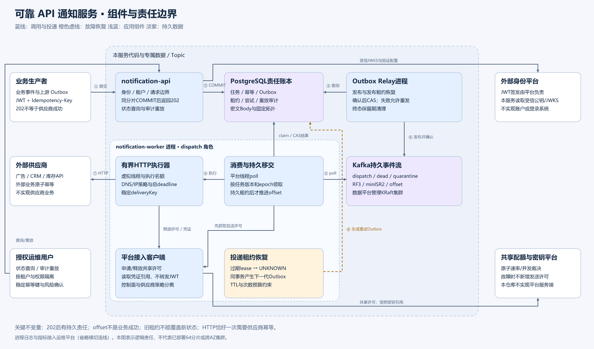
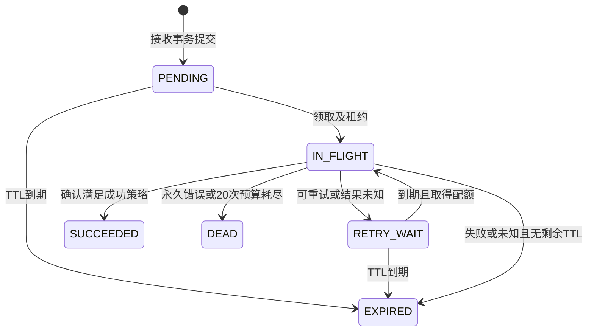
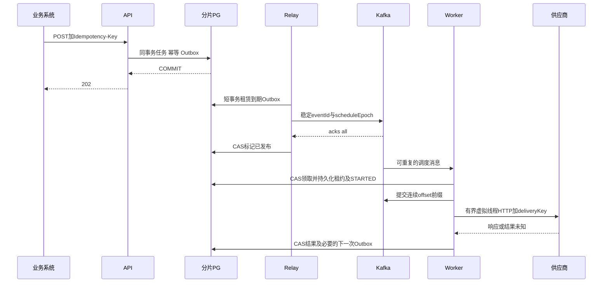

# 可靠 API 通知服务系统设计

版本：3.0。日期：2026-11-02。项目：rc_bill。状态：业务链路已实现；运行证据见验证记录，大规模容量仍需压测。

本服务接收内部业务系统的通知请求，将其可靠地投递给外部 HTTP(S) API。API 接收与外部投递解耦，以分片 PostgreSQL 的任务/幂等/Outbox 短事务为接收一致性边界，以 Kafka 为主要投递分发通道，采用 MyBatis、Spring Boot 与 Spring Cloud 构建 API、Relay、Worker 三种可独立扩容的运行角色。Relay与Worker共用worker模块，已支持按all、relay、dispatch角色启动。系统承诺在配置的期限与故障假设下持续尝试投递，并显式保留失败任务；不能承诺任意供应商永远可用，也不能单方面保证外部业务恰好执行一次。

本轮范围扩展为完整通知服务实现、集成测试、CI/CD及故障演练。本文的业务流程、存储和安全控制已经有实现及测试；容量、跨AZ容灾与生产SLO仍是待环境验收的目标，不能从功能测试推断已达到。集成测试与CI/CD纳入实现，实际执行状态以验证记录为准。实现按独立能力与回归测试分批提交，过程复盘见AI案例和验证记录。Kafka 参数、部署、offset 协议、PG 热点和虚拟线程详见 [Kafka 高流量可靠性设计](kafka-reliability.md)，与本文同属必读基线。

## 1 需求与边界

### 1.1 原始要求对应

需求来源：根目录 `AI_Coding_作业_2026-10-29.pdf`，共一页。

| 题目要求 | 设计落点 |
| --- | --- |
| 多个内部业务系统提交通知 | 租户与调用方隔离、POST 接口、配额、入口幂等 |
| 广告注册、CRM 状态、库存变更等通知 | 统一投递内核；供应商模板只描述 HTTP 交互，不实现周边业务 |
| 不同 URL、Header 和 Body | 受控且版本化的 destination 配置，调用方提供已适配的 Body 和允许的动态 Header |
| 调用方不关心外部返回内容 | 提交返回任务 ID；只暴露投递状态和错误分类，不回传供应商原始响应 |
| 可靠送达 | durable acceptance、持久重试、故障恢复、死信与人工重放、审计 |
| GitHub 仓库及 README | 本地Git、README及GitHub仓库，提交与CI记录可审阅 |
| 完整未删改 AI 会话 zip | 最终交付检查项；当前会话尚未结束，最终导出后入库，不以人工摘要冒充原始会话 |

### 1.2 服务所有权

本服务负责接收、校验、持久化、调度、发送、结果分类、状态查询、人工重放和运行可观测性。范围包含 destination 配置加载与校验，但第一版不做管理 UI 或配置管理 API；采用经审查的部署配置发布不可变版本。

业务事件生产者负责“业务事务提交后必有通知请求”，应通过自己的事务 Outbox 重试调用本服务；它不是本服务实现范围。广告平台、CRM、库存系统、OIDC 身份平台、Vault/KMS、出口代理、监控平台均作为外部依赖，只实现本服务侧适配器。测试不得连接真实供应商或修改真实库存。

### 1.3 设计假设

- 通知互相独立，不保证跨请求 FIFO；库存等顺序敏感调用必须由对方按事件版本拒绝旧事件，或者未来另行引入 ordering key 与串行消费，第一版不宣称有序。
- 默认只允许 HTTPS 443。题目中的 HTTP 兼容限定为经过安全审查的专用受控出口，不能由请求临时开启。
- 调用者提交目标所需的 UTF-8 Body 原文，可用于 JSON、表单或纯文本；服务不实现任意脚本、模板表达式、XML 解析或业务字段转换。复杂转换由业务方或后续专门适配器承担。
- 单通知一个 destination，一个请求不跨多个供应商扇出；业务方需要多个通知时使用不同幂等键分别提交。
- destination 不允许业务方任意指定 URL。管理员预配置 URL、method、允许 Header、Body 类型、授权凭证引用和供应商成功判定规则。
- 以下容量为明确的初始设计预算，需压测后调整；并非题目给定数据。

## 2 服务等级与交付语义

| 项目 | 设计目标与条件 |
| --- | --- |
| 接收可用性 | 月度 99.9%；以合法授权请求为分母，容量拒绝计入可用性损失，排除调用方 4xx |
| 接收延迟 | 峰值预算内 P95 ≤ 150 ms，P99 ≤ 300 ms；包含数据库提交，不含外部投递 |
| 首次尝试 | 供应商健康、未触发配额且无积压时，99% 在接收后 5 秒内开始 |
| 持久性 | 已确认接收的任务在单实例/单数据库节点故障下 RPO 0，依赖同步副本与可靠存储；区域全毁另设 RPO ≤ 5 分钟 |
| 恢复 | 应用故障由其他实例接管；数据库故障切换目标 ≤ 60 秒；区域恢复目标 RTO ≤ 60 分钟，需演练 |
| 重试期限 | 默认 24 小时，最多 20 次网络尝试，先到者为准；可请求 60..86400 秒较短 TTL |
| 查询保留 | 终态元数据及尝试记录保留 30 天；Body 终态后 7 天删除；人工重放仅在 Body 存在时允许 |
| 入口幂等保留 | 从原始接收/重放接收起 30 天，且不得早于对应任务进入终态；过期后同 key 可创建新通知 |

202 表示本服务已持久化承担投递责任，不表示供应商成功。入口响应丢失时调用者使用同一 key 重试。供应商成功处理但响应丢失或本服务写回前崩溃时，将再次投递；任务“未确认成功”不等于外部没有产生效果。

整体是至少一次尝试/投递语义，有限 TTL 与永久错误下可能没有成功送达。供应商长期不可用、非法请求或预算耗尽进入 DEAD/EXPIRED 并告警，不能静默删除。只有供应商自身提供足够长的幂等窗口与原子去重，才可保证窗口内一次业务效果；没有幂等能力的库存扣减必须明确承担重复风险，不能伪称 exactly-once。

## 3 架构与技术选择



[可缩放架构图](diagrams/architecture.svg)。图中每一步对应独立的持久责任或外部副作用边界；Kafka与PG不是同一事务。完整审查与修订依据见[设计审查](design-review.md)。

Kafka负责高吞吐分发和削峰，PG保留强一致幂等、状态、租约、重试计划和审计。正常投递由Kafka事件驱动，不再轮询PG任务表领取；PG只扫描到期Outbox与异常恢复索引。202只在任务、幂等及Outbox同一分片事务提交后返回，不等待Kafka同步发布。已接收任务即使Kafka暂不可用仍有责任账本；超过持久积压预算后拒绝新请求。

| 技术 | 决策及理由 |
| --- | --- |
| Java | 保持21编译目标，虚拟线程已纳入runtime并有执行器测试；生产优先评估25 LTS，21的pinning风险需单独压测 |
| Spring Boot 4.1.2 / Cloud 2025.1.4 | MVC、Actuator、CircuitBreaker；不额外搭建注册中心 |
| MyBatis Starter 4.1.0 | 使用Mapper和显式SQL，支持批量、唯一冲突和租约CAS；不使用JdbcTemplate编写仓储 |
| Spring事务 / Hikari / PostgreSQL驱动 | MyBatis依然经JDBC访问PG，保留Spring事务基础设施，不把“不用Spring JDBC写SQL”误解成删除底层JDBC依赖 |
| PostgreSQL 17分片 | 4096逻辑slot初始映射64个物理主分片，跨区同步备库；SQL和事务只在一个分片内完成 |
| Spring for Apache Kafka | 采用Boot管理的Spring Kafka 4.1.2、kafka-clients 4.2.2，直接管理offset与容器配置；无需额外Cloud Stream抽象 |
| Kafka 4.2.2 KRaft | 初始12 brokers、3独立controllers、3可用区；详细可靠性参数见专项设计，上线固定镜像digest并审查补丁 |
| Flyway | 已提供独立迁移入口/Job，不在应用副本启动时竞争DDL |
| Apache HttpClient 5 | 已实现单次有界发送、DNS截止时间、禁止自动重试/重定向；虚拟线程执行前先取得有限名额 |
| 配额与密钥平台 | 外部依赖只实现客户端适配，禁止在本项目重写其服务端 |
| JUnit / AssertJ / WireMock / Testcontainers | 已提供单元/组件测试与Docker Compose真实PG/Kafka集成；供应商用JDK HTTP fixture模拟，跨AZ和目标容量仍另验收 |

### 3.1 MyBatis使用约束

当前使用MyBatis注解与文本块保存固定SQL，包含CAS、Outbox及claim；所有参数使用`#{}`绑定，禁止用`${}`拼接租户值、表名或排序字段。动态分片/表名只能来自内部白名单路由。仓储方法负责事务边界，同一事务的Mapper和事务管理器必须使用同一DataSource；禁止业务方法中途切换分片或用两个数据库事务冒充原子操作。

关闭MyBatis二级缓存，`localCacheScope=STATEMENT`，读取幂等/租约不使用可能过时的ORM会话缓存。所有CAS检查影响行数，所有批量操作检查批次执行结果；不要依赖BATCH executor尚未flush时的返回值证明领取成功。配置statement timeout、lock timeout、连接等待上限与UTC时间映射，Mapper集成测试使用真实PG，不以H2替代ON CONFLICT/SKIP LOCKED语义。

PgBouncer若使用transaction pooling，不能依赖跨事务的会话变量、临时表或会话锁。上线前核对所选PgBouncer版本对协议级prepared statement的支持并配置池预算；兼容性未验收时使用PG JDBC `prepareThreshold=0`作为显式兼容方案并压测影响，不能只在直连PG单测中验证后就默认池化连接行为相同。

runtime已装配MyBatis仓储、事务、Kafka和安全链；scaffold仍禁用基础设施并返回501。两种模式必须区分，具体启动和真实测试方式见[运行文档](runtime-and-operations.md)。

## 4 模块与组件设计

```text
notification-domain       状态与值类型，不依赖 Spring
notification-application  用例和端口，依赖 domain
notification-adapters     数据库、HTTP、配置、密钥等适配器边界
notification-api          接口和进程装配
notification-worker       调度和进程装配
contracts/openapi.yaml    面向调用方的目标契约
```

### 4.1 接收组件

执行顺序：验证身份/授权 → 限制原始 HTTP 字节数与解析深度 → DTO 校验 → 计算请求指纹 → 查询幂等记录 → 对新请求验证 destination 版本及权限 → 容量预检查 → 开启数据库事务 → 在同一分片插入幂等记录、任务、Body和Outbox → 提交 → 返回 202。幂等命中应在拒绝新流量的积压检查前处理；已接收请求不应因目标之后停用而失去可查询响应。

同 key 冲突通过唯一约束解决，不能先查后插后假定无竞争。并发输家用 `INSERT ... ON CONFLICT DO NOTHING` 后在 READ COMMITTED 的下一条语句重读已提交赢家；如果事务超时返回 503，调用方仍用原 key 重试。幂等记录指向任务，任务与Outbox同事务创建，绝不先写“成功幂等”再异步保存任务。

### 4.2 Kafka调度与执行组件

接收、人工重放、失败重试均在PG事务内创建稳定eventId的Outbox记录；Relay将到期事件发布到Kafka并等待确认后标记PUBLISHED。确认丢失或发布后崩溃允许重复发送同一事件，消费者按任务状态和scheduleEpoch去重。eventId标识事件，scheduleEpoch标识调度代次，deliveryKey标识外部业务去重身份，三者不能混用。

平台poll线程接收记录，先获得本地有限执行名额，再按notificationId精确路由PG，通过CAS领取当前epoch并持久写IN_FLIGHT租约及STARTED attempt。只有持久移交完成后才提交连续offset前缀。之后才交由虚拟线程执行HTTP；即使提交offset后进程立刻退出，也由PG租约恢复器补发调度。不能以“已提交到线程池”代替持久责任移交。

HTTP租约60s，总deadline10s，结果写回预算5s；领取计入最多20次网络预算，崩溃发生在发送前也可能消耗一次保守预算。HTTP前复核租约、配额及TTL，网络期间不持有数据库连接。结果写回按tenant、task、IN_FLIGHT、lease_token做CAS，影响0行则只记录迟到结果。

可重试结果在同一事务更新attempt和RETRY_WAIT、计算nextAttemptAt、递增scheduleEpoch并插入available_at到期的Outbox。Relay到期发回dispatch topic，消费者不sleep等待、不热循环立即重发。过期租约标UNKNOWN后按相同事务协议恢复；TTL过期扫描必须覆盖不能被正常领取的行。限流/熔断延后不消耗网络次数，但消耗TTL。

重平衡、offset提交失败、未知任务、毒消息与失效恢复的完整协议见 [Kafka消费与offset](kafka-reliability.md#3-消费与提交-offset)。consumer、relay、租约恢复和保留期清理均已有实现及真实基础设施测试。

### 4.3 供应商配置组件

destination 配置字段：`id, version, allowedTenants, allowedClients, enabled, endpoint, method, contentTypes, staticHeaders, allowedDynamicHeaders, credentialRef, idempotencyHeader, idempotencyWindowSeconds, successPolicy, retryPolicy, rateLimit, concurrencyLimit`。版本发布后不可修改，变更创建新版本；新提交必须显式指定版本，不采用隐式 latest。

接收时保存非敏感不可变投递快照及快照摘要，重试使用同一 URL/method/body/成功规则。密钥只保存引用，在发送时取当前有效版本；轮换不能改变通知业务语义。当前目标配置在进程启动时加载，停用通过发布配置并滚动重启Worker生效，暂停期间TTL继续流逝；已经发出的HTTP不能撤回。亚秒级全局封禁应由受控出口或后续配置推送能力承担，当前不提供热配置管理服务。管理员修复配置后如需要换目标或 Body，必须发起新业务通知，不能偷偷修改原任务。

以下是概念结构示意；可直接运行的JSON配置由`prepare-demo.py`生成，完整字段与外部契约见运行文档：

```yaml
id: crm-contact-status
version: 1
endpoint: https://crm.example.com/v1/contact/status
method: POST
contentTypes: [application/json]
allowedDynamicHeaders: [X-Correlation-ID]
credentialRef: vault://notification/crm
idempotencyHeader: Idempotency-Key
idempotencyWindowSeconds: 2592000
successPolicy: HTTP_2XX
```

### 4.4 端口责任

| 端口 | 输入与输出 | 关键约束 |
| --- | --- | --- |
| NotificationUseCases | submit/get/attempts/replay | 身份上下文必传；越权资源返回 404 |
| NotificationStore | 接收及幂等原子写、查询、重放原子写 | 返回 Created/Existing/Conflict；事务在适配器内部闭合 |
| DeliveryQueue | 按事件代次claim、complete、recoverExpired | 不扫描正常任务；lease token必传，重试与Outbox原子写 |
| OutboxStore / DispatchPublisher | 到期发布租约、确认、Kafka发送 | 只在Kafka确认后markPublished，重复发布保持eventId不变 |
| DestinationCatalog | 授权范围、目标 ID 和版本 → 配置 | 返回不可变版本；未知/无权配置统一 422 |
| SecretProvider | 可信配置中的引用 → 短期密钥材料 | 业务方不能提交任意 secret URI；不得日志输出 |
| HttpTransport | 已构造的 HTTP 请求 → 有界结果 | 不重试、不重定向、不无限读取响应 |
| DispatchAdmission | destination → 可关闭的配额许可 | 同时限制速率和并发，不可用时不发送 |

用例与端口已有具体适配器。数据表以Flyway迁移为准，框架参数绑定及真实PG行为有独立回归测试，不把接口存在视为功能完成。

## 5 数据设计与一致性

### 5.1 表结构设计

所有时间使用 `timestamptz` 存 UTC；API 使用 RFC3339 UTC。任务ID使用带12位logicalSlot路由字段的内部UUIDv8方案，其余字段为48位毫秒时间和62位随机数，布局已由边界测试固定；公共API保持opaque UUID，ID不是访问凭证。Body 按 UTF-8 字节加密保存为 bytea，不能使用 jsonb 改写原始字符串。

| 表 | 主要字段 | 约束与用途 |
| --- | --- | --- |
| notification | id, tenant_id, client_id, slot, destination_id, destination_version, snapshot, fingerprint, root_id, replay_of, delivery_key, status, attempt_count, schedule_epoch, next_attempt_at, expires_at, lease_token/until, created_at, completed_at, last_error | PK(id)；CHECK attempts≥0；IN_FLIGHT 必有租约，其余状态无租约；终态 completed_at 必填；Body存在性由payload表判断 |
| idempotency_record | tenant_id, client_id, operation_scope, key, fingerprint, notification_id, retain_until | UNIQUE(tenant_id,client_id,operation_scope,key)；FK notification；保留任务 tombstone 直到去重窗口结束 |
| delivery_attempt | notification_id, attempt_no, lease_token, started_at, finished_at, outcome, http_status, error_code, elapsed_ms, provider_request_id | PK(notification_id,attempt_no)；outcome STARTED/SUCCEEDED/RETRYABLE/PERMANENT/UNKNOWN；不存原始响应 |
| replay_audit | id, actor, original_id, replay_id, reason, risk_acknowledged, created_at | 与 replay 创建同事务；只追加 |
| delivery_chain | root_id, active_id | 同一原始投递链同分片加锁，防止祖先重放绕过活跃约束 |
| outbox_event | event_id, notification_id, schedule_epoch, event_type, scheduled_at, available_at, publish_state, lease_token/until, payload, published_at | UNIQUE(notification_id,schedule_epoch,event_type)；不含业务Body，未发布不清理 |
| payload | notification_id, ciphertext | 与窄状态行分离，同分片，默认终态7天清理；避免状态更新反复改写大Body |

表已由Flyway可执行迁移创建，另有topology_guard约束数量及物理分片身份、destination_version登记不可变投递语义。生产使用独立迁移命令/Job，不让应用副本竞争DDL。

### 5.2 索引与事件驱动领取

- 幂等唯一索引包含tenant/client/operation/key，所有同key请求按稳定logicalSlot落同一物理分片；不能仅在每个库创建相同索引后随机路由。
- notification按ID定位并CAS当前epoch；`(lease_until,id) WHERE status='IN_FLIGHT'`用于异常租约恢复，`(expires_at,id) WHERE status IN ('PENDING','RETRY_WAIT')`用于过期处理。
- Outbox采用`(available_at,event_id) WHERE publish_state='PENDING'`和发布租约过期索引；分片内固定lane分工避免一个全局扫描器，分批更新与归档。
- attempt按notification_id/attempt_no游标分页；状态查询从ID解析slot，默认主库，避免接收后读副本404。禁止每次查询广播64库。
- 幂等表保留30天且不早于终态；不能按事件日期分区后让同key跨日期获得多个唯一约束。采用hash slot保证去重局部性；attempt/Outbox等追加表可按日期分区清理，约束须包含分区键并保持应用唯一不变量。
- Body独立表加密；窄状态表保留可查询元数据。终态元数据30天的成本已计入高流量容量预算，不假定Kafka可以承担所有随机状态查询。

正常领取伪SQL，业务层需先完成TTL、预算、配额和事件校验，真实实现用MyBatis Mapper绑定参数：

```sql
BEGIN;
UPDATE notification
   SET status='IN_FLIGHT', lease_token=:token,
       lease_until=clock_timestamp()+interval '60 seconds',
       attempt_count=attempt_count+1
 WHERE id=:id AND tenant_id=:tenant
   AND schedule_epoch=:event_epoch
   AND status IN ('PENDING','RETRY_WAIT')
   AND next_attempt_at <= clock_timestamp()
   AND expires_at > clock_timestamp()+interval '10 seconds'
   AND attempt_count < 20;
-- 影响1行才INSERT STARTED attempt；0行重读分类，不能直接当成功
COMMIT;
-- 此后才能推进Kafka offset，之后异步HTTP
-- complete事务同时更新任务/attempt，重试时INSERT下一代Outbox
```

SQL为协议示意，实际Mapper参数采用`#{}`而不是字符串拼接。READ COMMITTED配合唯一约束与CAS；DB纯事务冲突可有限重试，不包住HTTP。Kafka offset与PG不在一个事务，因此顺序为PG先提交、offset后提交；中间失败允许消息重读，用PG已提交状态消除重复推进。

### 5.3 入口指纹与出站幂等

入口 key 长度 8..128，字符 `[A-Za-z0-9._:-]`，作用域 `(tenant,client,operation)`；submit operation 固定 `submit`，replay operation 包含原任务 ID。同一 scope+key+fingerprint 返回同一任务；key 相同而 fingerprint 不同返回 409。

指纹包含 destinationId/version、contentType、动态 Header、Body 精确 UTF-8 字节、默认值已展开的 TTL。规范化使用结构化、有长度界限的确定性编码再做 SHA-256，不能直接拼接易碰撞的字符串。Header 名大小写归一后排序；大小写重复 Header 拒绝，Header 值不做会改变语义的 trim；Body 空白和 JSON key 顺序有意义。排除 traceparent、认证令牌和入口 key 本身。实现时冻结测试向量。

出站 `delivery_key` 是服务生成、租户隔离的稳定随机键，从首次尝试到重试/人工重放都不改变，映射到供应商支持的幂等 Header。不能把每次 attempt ID 当出站幂等键。provider 只支持 Body 内幂等字段时需专门可信适配器；通用原文透传版本不自动修改 Body。

### 5.4 人工重放

仅具备 `notifications:replay` 且属于原 client 的操作者可将 DEAD/EXPIRED 任务创建为新子任务；原状态不回滚。原任务不存在/跨租户返回 404，非终态或 SUCCEEDED 返回 409，Body 已删除返回 410。重放保留原 Body、快照、delivery_key，新 task ID、24h TTL、尝试预算从 0 开始，审计 reason 必填。

原任务行加锁，保证同一个 delivery_key 链同时最多一个非终态任务。相同 replay key 返回相同子任务；不同 key 并发时只有一个创建成功，其余 409。重复子任务可在其终态后继续重放，但不能通过重放早先祖先绕过链检查。使用同分片`delivery_chain`根行锁约束，原始与所有重放子任务始终位于原logicalSlot；新子任务和审计、幂等、Outbox同事务写入。

供应商不支持幂等或最早一次投递至新 TTL 结束可能超过供应商去重窗口时，只有 `acknowledgeDuplicateRisk=true` 且具备 replay scope 才允许重放，否则 409。这只是操作者知情确认，不提供技术去重保证。

## 6 状态机与时序



终态不自动回到待投递。EXPIRED 只在无有效执行租约时由过期扫描设置；已经发起且仍持有有效租约的请求如果成功，即使刚跨过 TTL，仍记录 SUCCEEDED。TTL 是“最晚允许开始新尝试的时间”；开始前还要求剩余 TTL 足够执行总 deadline，否则不发送并过期。正在执行的请求不能靠改变状态取消其外部效果。



offset已提交只表示持久移交，不等于供应商成功。任意中间崩溃都有PG状态、Outbox或租约恢复路径；恢复器必须作为生产ready条件纳入验收。

## 7 超时重试与供应商隔离

### 7.1 结果分类

| 结果 | 默认处置 |
| --- | --- |
| 200..299 | HTTP_2XX 策略成功；202 仅代表供应商已接收，不证明业务最终完成 |
| 200 但业务码失败 | 使用该 destination 经单测验证的有界响应判定器；未配置时仅承诺 HTTP 接收语义 |
| 301/302/307/308 | 禁止自动跟随，作为配置错误 DEAD，避免绕过出口安全和泄露凭证 |
| 400/404/405/410/422 | 默认永久失败 DEAD |
| 401/403 | DEAD 并告警，轮换/权限修复后人工重放，不无限打供应商 |
| 408/425/429/500/502/503/504 | 可重试；429/503 解析 Retry-After |
| 409 | 默认永久失败；仅供应商明确约定“重复且已成功”时按特定判定器成功 |
| 其他 4xx/5xx | 默认永久失败，版本化策略可显式覆盖，避免对不支持/协议错误无限重试 |
| 连接失败、临时 DNS、连接重置 | 可重试；不能确信未产生副作用时 outcome=UNKNOWN |
| 读超时、请求已写出后断连 | UNKNOWN，可重试但存在重复效果 |
| TLS 证书错误、安全封禁、非法配置 | 永久错误或暂停目标并告警，不放宽证书验证 |
| DB 写回失败 | 不启动额外 HTTP；租约恢复后 UNKNOWN，保留重复可能 |

供应商响应最多读取 64 KiB，完成前限制解压后字节数和解析深度，禁用压缩或受控解压。超出判定所需上限时记 RESPONSE_TOO_LARGE 并按目标策略终止；即使对方可能成功也不无限重试大响应。只存 HTTP 状态、供应商请求 ID 和标准错误码，不存原始响应 Body 或令牌。

### 7.2 统一重试预算

第 n 次失败后（n 从 1 起）`jitter = Uniform(0, min(3600s, 2s * 2^(n-1)))`。为避免 0 延迟热循环设置最小调度间隔 200ms。`next_attempt_at = now + max(200ms, jitter, valid Retry-After)`；秒数与 HTTP-date 两种 Retry-After 均支持，过去日期按 0，非法值忽略并计数。对合法且超出剩余 TTL 的 Retry-After，直接 EXPIRED，不能裁短后提前重试供应商。

总尝试上限 20，首次也计入；TTL 优先于继续重试。HTTP 库、Feign、Resilience4j Retry 均不能再叠加重试。数据库写回可在剩余租约内少量重试且不重新发送。幂等入口重试由调用方控制，建议指数退避与同 key，429/503 尊重 Retry-After。

### 7.3 限流与熔断

Worker每实例最多1024个在途HTTP，提交到虚拟线程执行器之前取得本地名额；平台Kafka消费线程起始32个，二者不是同一个concurrency。HTTP连接池总量与在途预算对应，单路由按供应商合同设置，数据库连接池单独限额。虚拟线程便宜不代表连接、堆内存和下游服务无限。

原先“每次请求更新同一个PG供应商配额行”的方案取消。供应商配额使用外部配额/出口能力，按account归集，短窗口批量grant、稳定grantId去重、本地令牌与并发信号量配合；单provider仍存在需要串行的预算裁决，通过批次降低中央操作频率。Redis异步故障切换不能证明绝不超额，需暂停不确定epoch或由受控出口作最终硬限制；详细边界见专项设计第8节。

Resilience4j进程内熔断起点为最近50次、至少20次调用、失败率≥50%打开30s、半开最多3次探测。429主要驱动共享冷却，不当成网络故障无限重试。使用SemaphoreBulkhead避免再套线程池；熔断状态不是全局配额。没有配额/熔断打开则持久延后，不消耗网络attempt但消耗TTL。

Kafka按通知slot散列，不按provider形成单分区热点。大客户按key散列至多个PG分片；消费者对单目标积压通过持久延后和配额隔离，让同partition其他目标继续推进。调度公平性、最大延期事件率与重放限速均需压测，不能只凭增加partition宣称无饥饿。

## 8 HTTP API 契约

完整契约在 `contracts/openapi.yaml`，版本 OpenAPI 3.0.3。契约已由runtime四个接口实现；scaffold仍返回501供结构演示，不能混淆两种运行模式。

| 方法与路径 | 权限 | 成功结果 |
| --- | --- | --- |
| POST /v1/notifications | notifications:write | 首次及相同内容重复均 202，Location 指向状态资源；Idempotency-Replayed 标识重复 |
| GET /v1/notifications/{id} | notifications:read | 200 状态，不暴露 Body/敏感 Header/完整 URL |
| GET /v1/notifications/{id}/attempts | notifications:read | 200 游标页，limit 1..100 默认 20，afterAttempt 非负 |
| POST /v1/notifications/{id}/replays | notifications:replay | 202 新任务或已有重放任务，reason 必填 |

身份以已验证 JWT 的 issuer、audience、exp/nbf、tenant_id、client_id、scope 为准，校验 kid 算法白名单，限制时钟容差 60s；JWKS 缓存有效期内可继续用缓存，未知 key/无有效缓存时拒绝，不 fail-open。入口网关不能成为唯一授权层。客户端隔离默认同 tenant 同 client；跨 client 运维访问另设角色，第一版不开放。

请求 envelope 最大 128 KiB（UTF-8 编码），Body 最大 64 KiB；JSON 转义可能使 envelope 先超限，两项均须满足。contentType 只接受 `application/json`、`application/x-www-form-urlencoded`、`text/plain`，统一 UTF-8。body 可为空字符串以兼容空请求。Header 最多 16 项，每项名最多 64 字符、值最多 1024 字符、总 UTF-8 ≤8 KiB；Header值只允许可打印ASCII与HTAB，禁止 CR/LF、大小写重复和 Host/Authorization/Cookie/Content-Length/Transfer-Encoding/Connection/Proxy-*/X-Forwarded-* 等受控 Header。实际允许集合还须是 destination 白名单子集。

JSON 未知属性、重复属性、错误字段类型拒绝为 400，深度≤20。destinationId 为 `[a-z][a-z0-9-]{2,63}`；version 为正整数；UUID 非法返回 400。traceparent 只作为追踪信息，不能作为幂等或身份来源。时间统一 UTC，response Content-Type 对错误为 application/problem+json。

错误采用 Problem Details：`type,title,status,detail,instance,code,traceId`；detail 不含 SQL、堆栈、原始供应商内容。400 语法/字段约束，401 未认证，403 scope 不足，404 不存在或无对象访问权，409 幂等冲突/状态冲突/重放风险未确认，410 重放 Body 已清理，413 字节超限，415 Content-Type 不支持，422 未知/未授权/无效 destination，429 调用配额耗尽，503 存储不可用/背压/发布切换期间配置未齐。429/503 携带秒数 Retry-After。5xx 后必须允许客户端安全地使用原 key 重试，不能因未收到 202 就换 key。

API v1 只允许向后兼容的可选响应字段扩展，新增枚举值需与客户端兼容性协商，改变指纹算法/状态语义/字段含义必须新版本或显式迁移。OpenAPI 变更与对应 DTO、测试同提交。

## 9 安全与隐私

- HTTPS 校验证书链与 hostname，禁用 trust-all；目标 URL 禁止 userinfo、fragment、非允许端口及未经授权 query 凭证，Host 不接受业务方覆盖。
- 只允许管理员批准的 FQDN 和路径范围，禁止 localhost、环回、私网、链路本地、组播、保留 IPv4/IPv6、IPv4-mapped IPv6 及云 metadata 地址。DNS 解析结果全部校验；仅验证入库时 DNS 不足以抵御重绑定。
- Worker 出口仅允许经过代理，出口策略在实际连接时校验解析 IP 并固定已验证地址，同时保留正确 TLS SNI/hostname；禁止直连绕过。若实现直连适配器，必须完成受控 resolver 与连接绑定测试。禁止自动重定向，任何新 Location 都不能自动继承凭证。
- 业务 token 不转发到供应商。供应商授权从 Vault/KMS 获取，短期内存缓存、轮换、最小权限；Body/必要 Header 静态加密，备份同样加密。credentialRef 是引用，不是令牌。
- 日志只保留 task ID、租户脱敏标识、attempt、错误码、耗时和安全路径模板；禁止记录 Body、认证 Header、完整查询串。追踪 Baggage 白名单，供应商响应只抽取允许字段。
- 入口和出口分别限制字节、并发、时间、JSON 深度；入站压缩默认不接受。目标配置变更及重放必须审计，不允许通过普通 submit 修改目标策略。
- 默认保留期是技术假设，真实上线按数据分类与地区规定审查。删除按批执行，备份淘汰窗口明确；已删除明文不能通过备份恢复后自动重新投递，恢复流程需加载删除/抑制记录。

## 10 容量与并发预算

当前假设为平均20,000通知/s、峰值100,000通知/s持续10分钟、平均Body2KiB、正常尝试放大1.05、供应商平均耗时200ms。它替代v1的100/1000 QPS假设，属于待压测目标。

| 核心预算 | 结果 |
| --- | --- |
| 每日通知 | 17.28亿 |
| Kafka峰值dispatch | 105k事件/s；每事件约600B，逻辑60.1MiB/s |
| Kafka分区/部署 | dispatch2048分区，RF3、minISR2，12broker与3独立controller跨3AZ |
| Kafka7天dispatch副本容量 | 约20.79TiB，集群起始48TiB可用盘，另核算dead/quarantine与恢复余量 |
| PG峰值事务下限 | 接收+领取+写回约310k事务/s，另有Outbox、清理与查询 |
| PG分片起点 | 4096逻辑slot→64物理主分片，平均约4844事务/s/分片，真实事务压测目标留到约6500 |
| PG原始保留成本 | 7天Body+30天任务/幂等/attempt约114.26TiB；2倍余量后约228.5TiB主容量，副本/备份另计 |
| HTTP并发 | 105k×0.2s≈21k；2倍余量42k，64Worker×1024≈65k，单AZ失效后仍约43k |

PG仍承受每条接收的唯一约束和持久写，Kafka不能消除这个上限。MyBatis改善SQL可控性，也不等于自动提高TPS。同key是必须串行裁决的热点，用有界single-flight、结果缓存及限流缓解；不能通过随机加盐分散同key而破坏幂等。

分片路由、Kafka自定义partition映射、数据库连接总额、Body独立存储、索引与清理成本、延迟恶化时并发不足、背压门限及完整计算见 [容量与热点专题](kafka-reliability.md#8-postgresql-是否仍然需要)。未取得真实事务/磁盘/同步复制压测证据前，不承诺达到该吞吐。

## 11 故障与恢复矩阵

| 故障点 | 可观察结果 | 恢复与不变量 |
| --- | --- | --- |
| API提交前崩溃 | 未接收或客户端无响应 | 事务回滚；同key重试 |
| 提交成功但响应丢失 | 客户端不知道是否接收 | 同key返回原任务，不重复创建 |
| Worker领取后发送前崩溃 | STARTED无完成 | 租约超时标UNKNOWN再调度，计入预算 |
| 供应商成功后写回前崩溃 | 外部可能已成功 | 重试用相同delivery_key；无供应商幂等则可能重复 |
| 旧Worker晚到结果 | CAS影响0行 | 不覆盖新租约结果，记录迟到指标 |
| 单PG分片不可用 | 受影响slot的API503、consumer暂停 | 不ack未持久移交消息；其他分片继续，禁止广播式整体停机 |
| Kafka不可用/ISR不足 | Relay失败，Outbox增长 | 不markPublished；达到持久积压门限后拒绝新接收 |
| 发布成功但未标记Outbox | Kafka可能已有消息 | 重发相同eventId，按epoch/状态去重 |
| PG移交后offset提交失败 | 消费者会重读 | 已持久租约/终态可判重；不能重复推进同代次 |
| offset已提交但未执行HTTP就退出 | Kafka不一定再给该事件 | 强制依赖租约恢复器补发Outbox，不能仅依赖offset重放 |
| 消费组offset丢失/过期 | reset=none停下 | 按PG账本对账并初始化恢复水位，禁止自动latest |
| 密钥平台不可用 | 无法构造请求 | 有效缓存可用；无缓存延后并告警，不消耗网络预算 |
| 供应商持续429/5xx | RETRY_WAIT积压 | 尊重Retry-After、熔断、配额与TTL |
| 配置发布不一致 | API/Worker版本不匹配 | 先发布Worker支持版本再开放API；缺失版本暂停并告警，快照不可静默换版 |
| 主库切换 | 短时503/结果未知 | 同步复制RPO目标；旧主隔离防双主；客户端重试 |
| 从备份恢复 | 部分成功记录可能丢失 | 默认暂停所有出站，核对审计/供应商结果/去重窗口后分批恢复，禁止盲目全量重发 |

优雅停机：readiness摘流→停止领取→等待当前请求和结果写回最多30s→退出；Pod终止宽限期45s，租约60s提供余量。超时退出交给租约恢复。liveness只检查进程自身，不因数据库/供应商故障触发全体重启；readiness按角色检查必要分片、配置、Kafka消费/发布与恢复器；短暂Kafka故障时API仅在Outbox预算内继续接收，单个供应商故障不使全服务不可用。

## 12 可观测性与运行手册

额外监控Kafka ISR/离线分区/lag年龄/offset失败/重平衡、Outbox最老未发布年龄、各slot负载与唯一索引等待、配额grant和虚拟线程pinning。指标包括 accepted/deduplicated/conflict/rejected 计数、接收延迟、状态队列深度、最老待投递年龄、attempt结果与耗时、租约过期/迟到结果、熔断状态、限流、DB池等待、磁盘/WAL/复制延迟。指标标签只用受控 destination/错误类别，不以 notificationId/client自由文本作为高基数标签；task ID只放日志/trace。

初始告警：正常目标最老待投递>60s持续5分钟；DEAD/EXPIRED>0立即产生事件并按目标聚合；入口5xx>1%持续5分钟；DB连接使用>80%持续5分钟；磁盘<25%；租约过期率>0.1%；积压持续上升15分钟；同步副本不可用触发持久性风险告警。

运行顺序：确认错误分类和受影响目标→暂停异常目标或降低新流量→修复权限/凭证/供应商故障→检查幂等窗口与结果不确定性→小批重放并观察→解除限额。运维不能直接把 DEAD 改成 PENDING；使用带 reason 和审计的 replay 用例。生产日志与审计保留策略需和数据合规一起定案。

## 13 测试设计

### 13.1 单元测试与 TDD

新增行为遵循项目TDD规则，纯策略和边界组件验证行为，数据库与Kafka协议由真实基础设施测试验证；实际过程及出现过的失败如实记录，不把仅编译成功或mock结果当作业务完成。建议未来 application/domain 行覆盖≥85%、分支≥80%，阈值不是替代有效断言的目标，本阶段不配置会误导的业务覆盖率数字。

| 功能 | 必测场景 |
| --- | --- |
| 输入约束 | 空值、64KiB字节边界、中文UTF-8、JSON转义后128KiB、未知/重复字段、Header注入、大小写重复、非法TTL |
| 幂等 | 同key同请求、异Body/版本/Header/TTL、不同tenant/client、响应丢失、指纹默认值与固定向量、窗口过期 |
| 状态与租约 | 合法/非法转移、旧token写回、并发完成、崩溃各窗口、TTL边界、预算20次、过期扫描 |
| 重试 | 429日期与秒数、负数/溢出/非法Retry-After、抖动上下界、超TTL、重试次数从1开始、无多层重试 |
| HTTP与安全 | DNS重绑定/IPv6/私网、重定向、证书失败、超长响应、断连/超时、原文字节与Header保留 |
| 隔离 | 两租户越权读/重放、限流公平、单目标故障不耗尽全部并发、分布式配额未超发 |
| 重放 | 幂等键冲突、并发不同key、祖先链重复、Body过期、成功任务禁止、风险确认和供应商窗口边界 |

### 13.2 集成与故障测试

真实PG/Kafka和端到端测试已实现并在CI执行。下列项目中，单库事务、重复消息、租约、重放、分片路由和受控故障注入已有证据；真实主库切换、跨AZ、备份恢复与目标容量属于生产环境门禁，不能用同机Compose代替。

- Docker Compose启动真实PostgreSQL并执行Flyway；当前用32并发相同key验证只产生1任务、不同内容409、事务回滚无孤儿记录。
- 至少2个Worker消费重复/乱序epoch，验证精确CAS领取、持久handoff后的offset提交、rebalance和租约抢占、旧token无法提交、全局配额与公平性；不以单实例mock证明分布式正确性。
- JDK HTTP fixture模拟2xx/429/5xx/延迟/断连/大响应，并在“供应商已处理、本服务未记成功”窗口杀Worker，验证重复风险及稳定delivery_key。
- 验证数据库故障切换、同步复制丢失、清理与查询并发、Body删除后重放、恢复备份时暂停发送、密钥轮换和配置先后发布。
- 独立网络安全测试验证受控出口、DNS重绑定、IPv4/IPv6地址变体和禁止直连；普通mock URL校验不足以完成验收。
- 端到端用“生产者mock→真实API/MyBatis/PG→Outbox Relay→真实Kafka→真实Worker→供应商mock”闭环；真实外部业务系统不在测试实现范围。
- 压测100k/s持续10分钟、20k/s至少2小时稳定性及等效30天数据索引测试；对比平台/虚拟线程与JDK21/25，执行单AZ失效及重复消息风暴测试；记录P95/P99、最大DB TPS、队列恢复、CPU/内存/连接和数据不丢失断言。更长耐久测试作为生产门禁。

## 14 CI/CD 与生产部署

CI已实现合同校验、真实PG/Kafka测试、完整runtime演示、并发烟测及容器检查；CD提供精确commit门禁、digest镜像与迁移后滚动发布模板，默认不发布、不部署。未向真实生产环境部署。下文的完整企业门禁中，漏洞平台、镜像签名、SBOM及跨区域演练仍需环境接入，不能宣称已通过。

PR流水线已验证JDK21；JDK25性能/运行矩阵仍需后续环境验证。扩展门禁目标：固定Maven Wrapper→格式/静态分析→单元测试→OpenAPI lint与兼容性差异→架构依赖检查→真实PG/Kafka集成与Outbox/offset故障测试→依赖/密钥扫描→生成SBOM→构建非root镜像。缓存按pom与wrapper校验和分键；GitHub Actions固定commit SHA，最小permissions；外部PR不得取得部署密钥。依赖漏洞按组织策略阻断并记录豁免期限。

交付流水线目标：受保护分支和review→镜像签名/摘要→临时环境部署→独立Flyway迁移Job→冒烟与契约测试→人工发布门禁→API/Worker分别滚动或金丝雀→SLO观察→提升或回滚。生产OIDC短期凭证，不在仓库保存Kubeconfig或云密钥。

数据库采用expand/contract：先新增可兼容字段/索引→兼容旧版本Worker的应用→回填→观察→后续版本删旧字段。回滚应用不自动执行破坏性数据库down migration。新destination版本先让Worker可处理再允许API接收；禁止在回滚后留下只有新代码认识的不可处理任务。

部署需配置Pod资源requests/limits、反亲和、至少3可用区、PodDisruptionBudget、就绪/存活探针、45s终止宽限、NetworkPolicy、出口代理、secret注入、同步备库、WAL归档和恢复演练。HPA参考最老任务年龄与实际出口容量，不能仅以CPU或队列深度无限增加Worker。

## 15 当前实现验收与生产门禁

当前交付已实现：JWT隔离与严格请求约束、幂等持久接收、目标版本登记、MyBatis分片事务、Outbox发布、Kafka持久移交、有界虚拟线程HTTP、重试/恢复、状态/attempt查询、审计重放、背压和保留期清理。运行模式、CLI、外部共享配额契约及上线前条件见运行文档。

单元/组件与真实PG/Kafka测试、真实进程演示、容器启动均有CI证据。Kafka同机三broker不等于三AZ验证，两个隔离数据源不等于64个物理主库容量证明。生产SLO、跨域恢复、环境专用Egress、在线DEK轮换、批量配额租赁及供应商自定义业务码适配没有被小规模测试证明。

最终作业交付还需：GitHub仓库已通过SSH发布到`xiedeacc/rc_bill`；后续变更按授权范围更新。仍需导出所有实际参与作业的完整未删改AI会话为zip入库，记录来源和校验和。不可用摘要代替原始日志，不将未结束的当前会话归档描述为完整记录。

## 16 参考依据

- [Spring Cloud官方兼容矩阵](https://spring.io/projects/spring-cloud/)：2025.1系列自2025.1.2起支持Boot4.1，用于选型兼容性。
- [Spring Boot系统要求](https://docs.spring.io/spring-boot/system-requirements.html)：4.1.2支持Java17至27，本项目编译目标固定21。
- [Spring Cloud CircuitBreaker Resilience4j](https://docs.spring.io/spring-cloud-circuitbreaker/reference/spring-cloud-circuitbreaker-resilience4j.html)：熔断、隔离集成能力。
- [MyBatis Spring Boot要求](https://mybatis.org/spring-boot-starter/mybatis-spring-boot-autoconfigure/)与[事务集成](https://mybatis.org/spring/transactions.html)：选择MyBatis，底层保留Spring事务/JDBC。
- [Kafka专项参数及官方依据](kafka-reliability.md)：Kafka 4.2配置、部署、EOS边界、虚拟线程与JDK版本约束。
- [PostgreSQL SELECT锁定语义](https://www.postgresql.org/docs/17/sql-select.html)：SKIP LOCKED用于并发Relay的Outbox批次租赁与恢复扫描；Kafka主流程按ID精确CAS领取。
- [RFC 9110 HTTP语义](https://www.rfc-editor.org/rfc/rfc9110.html)：HTTP状态和Retry-After的协议依据。
- [OWASP SSRF防护](https://cheatsheetseries.owasp.org/cheatsheets/Server_Side_Request_Forgery_Prevention_Cheat_Sheet.html)：目标白名单、DNS/IP验证与重定向控制。

以上官方资料核对日期为2026-11-02；容量、保留期、SLO与策略数值为本项目设计决策，均须通过测试和真实供应商合同校准。
